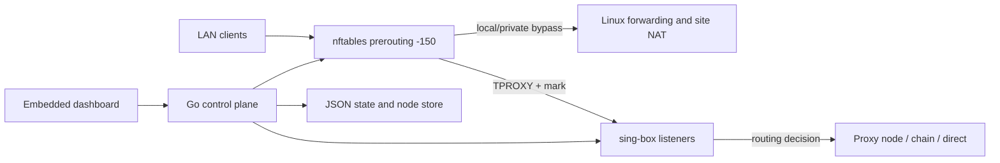

<div dir="rtl">

# HooLAN

برای سازگاری با نصب‌های موجود، نام فایل اجرایی و سرویس systemd همچنان
`proxy-manager` است و مسیر فایل‌ها و متغیرهای محیطی `PROXY_MANAGER_*` تغییر نکرده‌اند.

همهٔ فرم‌های ساخت در تب **پیکربندی‌ها** قرار دارند؛ فرم توزیع بار، فهرست قابل جست‌وجوی
گره‌ها را برای انتخاب اعضا نمایش می‌دهد. در تب **مصرف** می‌توانید گره‌ها و دستگاه‌ها
را بر اساس بیشترین دریافت یا ارسال مرتب کنید و محدودیت‌های سرعت ذخیره‌شدهٔ هر دستگاه
را کنار دکمهٔ **تنظیمات** ببینید. گره‌های بدون مصرف نمایش داده نمی‌شوند.
در تب **تنظیمات**، انتخاب خودکار، DNS و قواعد مسیریابی در بخش **مسیریابی و DNS**
قرار دارند؛ سپس بخش‌های اعلان‌های تلگرام و پشتیبان‌گیری و بازیابی آمده‌اند.


[English](README.md) · [گزارش بازبینی و پاک‌سازی](docs/consolidation-review.md)

یک دروازهٔ شفاف IPv4 برای رزبری پای یا میزبان لینوکسی. تنها یک فایل اجرایی Go،
داشبورد را ارائه می‌کند، تنظیمات را مدیریت می‌کند و بر اجرای **sing-box** نظارت
دارد. **nftables TPROXY** ترافیک شبکهٔ محلی را بدون نصب برنامهٔ پروکسی روی تک‌تک
دستگاه‌ها دریافت می‌کند. داشبورد با JavaScript، HTML و CSS ساده داخل فایل اجرایی
جاسازی شده است؛ مرحلهٔ ساخت جداگانه‌ای برای فرانت‌اند ندارد و ماژول Go نیز
**هیچ وابستگی خارجی ندارد**.

## امکانات

- **ورود به پنل با توکن:** احراز هویت با `PROXY_MANAGER_TOKEN`، نشست‌های
  HttpOnly/SameSite، محافظت CSRF، محدودسازی تلاش‌های ورود و احراز هویت Bearer برای API.
- **مدیریت پیکربندی‌ها:** اشتراک‌ها و گروه مجزای پیکربندی‌های دستی در یک زبانه،
  کارت‌های جمع‌شونده، پینگ و حذف گروهی موارد انتخاب‌شده و ویرایش پیکربندی دستی.
  همگام‌سازی موفق اشتراک، گره‌های حذف‌شده از منبع را پاک می‌کند؛ موارد متعلق به
  منابع دیگر یا مواردی که به‌صورت دستی هم ثبت شده‌اند حفظ می‌شوند.
- **زنجیره‌سازی چندمرحله‌ای (Multi-hop Chaining):** ساخت و ویرایش زنجیره‌های
  ۲ تا ۸ مرحله‌ای با ترتیب دلخواه. زنجیرهٔ ذخیره‌شده از نسخه‌های مستقل گره‌ها استفاده می‌کند.
- **توزیع بار فعال‌ـ‌فعال (Active-Active Load Balancing):** گروه‌بندی ۲ تا ۳۲ گره
  یا زنجیره. nftables بر اساس مشخصات هر اتصال، آن را به یکی از ورودی‌های مجزای
  TPROXY در sing-box هدایت می‌کند؛ اتصال‌های هم‌زمان می‌توانند از اعضای مختلف عبور
  کنند. این روش با نسخهٔ اصلی sing-box کار می‌کند و به خروجی بومی `loadbalance`
  وابسته نیست. سرعت یک دانلود را تجمیع نمی‌کند و عضو خراب را خودکار کنار نمی‌گذارد.
- **مسیریابی تفکیکی هر دستگاه (Split Tunneling):** انتخاب پیش‌فرض عمومی، اتصال
  مستقیم، یک گره، زنجیره یا گروه توزیع بار برای IP هر دستگاه؛ نام و مسیر دستگاه ذخیره می‌شوند.
- **محدودسازی سرعت هر دستگاه با QoS:** چهار سقف مستقل برای ارسال/دریافت پروکسی
  و ارسال/دریافت مستقیم، در پنجرهٔ تنظیمات دستگاه. خالی یا صفر برای آن دسته یعنی
  نامحدود؛ توضیح تأخیر تشخیص مسیر را پایین‌تر ببینید. محدودیت مستقیم در حالت خاموش هم برقرار است.
- **مسیریابی و DNS:** ویرایش قانون عبور مستقیم ایران، قوانین دامنه/CIDR و منابع
  کامپایل‌شدهٔ GeoIP/geosite با پسوند `.srs`؛ به‌روزرسانی دستی، فاصله‌ای، روزانه
  یا هفتگی با ساعت و منطقهٔ زمانی، نمایش مسیر فایل‌ها و وضعیت به‌روزرسانی.
- **زبانهٔ مصرف:** مجموع ترافیک موتور، پیکربندی‌های دارای مصرف و دستگاه‌های نام‌گذاری‌شدهٔ
  شبکه. تفکیک مصرف دستگاه/گره/مسیر مستقیم بر پایهٔ نمونه‌برداری است و برای صورتحساب دقیق نیست.
- **لاگ زنده با SSE:** توقف/ادامه، بازپخش محدود، پوشاندن اطلاعات حساس و مدیریت
  مشترک‌های کند. لاگ‌های سرویس و sing-box در journald نیز ثبت می‌شوند.
- **پوستهٔ روشن/تیره و رابط فارسی/انگلیسی:** ذخیرهٔ ترجیحات در مرورگر و چیدمان راست‌به‌چپ.
- **ابزارهای عملیاتی:** اعلان تلگرام با ارسال مستقیم یا از طریق پروکسی و دکمهٔ
  آزمایش؛ پشتیبان‌گیری و بازیابی ZIP؛ سنجش واقعی سرعت دانلود از گرهٔ انتخابی و اشتراک‌گذاری QR.

پیوندهای پشتیبانی‌شده: `vless://`، `vmess://`، `trojan://`، `ss://` و
`hysteria2://` / `hy2://`، همراه با گزینه‌های پشتیبانی‌شدهٔ TCP/WS/gRPC/HTTP، TLS و Reality.
فقط برای رسم QR، یک کتابخانهٔ کوچک با نسخهٔ مشخص هنگام نیاز از CDN بارگیری می‌شود.
پیوند اشتراک‌گذاری در مرورگر رسم می‌شود و در صورت شکست بارگیری، امکان کپی پیوند وجود دارد.

## معماری و محدودهٔ عملکرد

<div dir="ltr">



</div>

پای باید IP ثابت در شبکهٔ محلی داشته باشد و **مسیر پیش‌فرض خودش به روتر بالادست**
اشاره کند. DHCP، نشانی پای را به‌عنوان دروازه به کلاینت‌ها می‌دهد. ابتدا مطمئن شوید
پای در حالت خاموش بودن پروکسی مانند یک روتر معمولی کار می‌کند؛ سپس رهگیری را فعال کنید.

هنگام روشن کردن، مدیر ابتدا پیکربندی را می‌سازد و بررسی می‌کند، sing-box را اجرا
می‌کند و مالکیت **تمام سوکت‌های TCP و UDP روی IPv4 و نشانی wildcard** را تأیید
می‌کند؛ سپس رهگیری و مسیریابی سیاستی را نصب می‌کند. علامت پیش‌فرض `0x1` جدول `100`
را انتخاب می‌کند و مسیر محلی این جدول، بسته را از طریق `lo` برای تحویل محلی آماده
می‌کند. هنگام خاموش کردن، قواعد رهگیری پیش از توقف موتور حذف می‌شوند. در صورت
خرابی موتور نیز پاک‌سازی انجام می‌شود؛ اما اگر حذف قواعد شکست بخورد یا مسیریابی
عادی میزبان تنظیم نشده باشد، ادامهٔ اتصال تضمین‌شده نیست.

ترافیک سرویس‌های خود پای پیش از DNAT داکر از رهگیری مستثنی می‌شود. خروجی معمول
sing-box اتصال تازه‌ای با مبدأ پای است و از مسیر پیش‌فرض میزبان استفاده می‌کند؛
نباید علامت TPROXY را برای `routing_mark` این خروجی‌ها به کار برد. ترافیک عبوری
کلاینت‌ها به مجوز دیوارهٔ آتش و مسیر برگشت معتبر، یا SNAT/MASQUERADE با دامنهٔ
محدود نیاز دارد. **خاموش کردن موتور، تنظیمات روتر/NAT و QoS را حذف نمی‌کند.**

ترتیب تصمیم‌گیری مسیر: جلوگیری از حلقهٔ اتصال به ورودی → تشخیص پروتکل (sniff) →
ارسال DNS رهگیری‌شده → مقصدهای خصوصی → قوانین سفارشی/ایران → مسیر دستگاه یا
ورودی توزیع بار → پیش‌فرض عمومی. **DNS Hijacking فعال نیست:** پرس‌وجوی DNS
رهگیری‌شده از پروکسی انتخابی به همان resolver اولیه فرستاده می‌شود. ترافیک AdGuard
محلی از رهگیری عبور نمی‌کند. تنظیم DNS پنل، resolver خود sing-box را تغییر می‌دهد؛
DNS اعلام‌شده توسط DHCP یا تنظیمات AdGuard را تغییر نمی‌دهد.

QoS از حذف بسته‌های اضافه بر سقف (policing) استفاده می‌کند، نه شکل‌دهی ترافیک با صف.
محدودیت ارسال در اولویت `-149`، پس از رهگیری و پیش از تحویل به برنامه، و محدودیت
دریافت در `postrouting` با اولویت `99`، پیش از SNAT، اجرا می‌شود. علامت رهگیری
به‌تنهایی تصمیم مستقیم/ایران داخل sing-box را نشان نمی‌دهد. نمونه‌های یک‌ثانیه‌ای
Clash، مجموعه‌های موقت مشخصات اتصال را به‌روز می‌کنند. تا پیش از تشخیص مسیر، سقف
غیرصفر سخت‌گیرانه‌تر همان جهت اعمال می‌شود؛ اتصال‌های کوتاه، نبود نمونه یا مشغول
بودن عملیات مدیریتی می‌توانند این وضعیت را طولانی کنند. بنابراین حتی یک دستهٔ
نامحدود ممکن است موقتاً با سقف دستهٔ دیگر محدود شود. ترافیک عبوری عادی بلافاصله
از محدودیت مستقیم استفاده می‌کند. [جزئیات QoS](docs/load-balancing-qos.md) را ببینید.

این معماری برای **IPv4 و یک دروازهٔ منفرد** است. ترافیک IPv6 ممکن است خارج از مسیر این دروازه عبور کند؛
تنظیمات IPv6 شبکه را آگاهانه تعیین کنید. ترافیک داخلی که از پای عبور نمی‌کند قابل
محدودسازی نیست. برای دستگاه‌ها رزرو DHCP تعریف کنید. آمار مصرف شامل ارسال عادی
در حالت خاموش، سربار پروتکل و ترافیک خارج از sing-box نیست و ممکن است اتصال‌های
کوتاه را نبیند. زنجیره و توزیع بار، جایگزین دسترس‌پذیری بالای خود پای نیستند.

## پیش‌نیازها

- Raspberry Pi OS یا Debian Linux، ترجیحاً اتصال کابلی و IPv4 ثابت.
- نسخهٔ اصلی **sing-box با پیکربندی سازگار با 1.14** و پشتیبانی Clash API؛
  هر نسخهٔ جدید را پیش از ارتقا آزمایش کنید. نصب از
  [راهنمای رسمی بسته‌ها](https://sing-box.sagernet.org/installation/package-manager/).
- `bash`، `nftables`، `iproute2`، `procps`، `util-linux` برای `flock`، systemd و
  دسترسی root برای مدیریت دیوارهٔ آتش و پردازه‌ها. نصب‌کنندهٔ اختیاری روتر به
  UFW فعال و Python 3 نیز نیاز دارد.
- ابزار Go سازگار با حداقل نسخهٔ 1.21 ماژول، یا فایل اجرایی ARM ساخته‌شده روی
  دستگاه دیگر. برای استقرار از نسخهٔ تحت پشتیبانی Go استفاده کنید.

در مثال‌ها: پای `192.168.3.5`، روتر `192.168.3.1`، شبکه `192.168.3.0/24`، رابط
`eth0`، داشبورد `8080`، ورودی TPROXY روی `7892` و Clash روی `127.0.0.1:9090` است.
این مقادیر را با شبکهٔ خودتان جایگزین کنید. CIDRهای مربوط به رهگیری از نشانی‌های
واقعی رابط شبکه خوانده می‌شوند.

## نصب

### ۱. آماده‌سازی میزبان و ساخت

<div dir="ltr">

```bash
sudo apt-get update
sudo apt-get install nftables iproute2 procps util-linux ca-certificates curl
sing-box version
ip -4 route show default
```

</div>

sing-box را طبق راهنمای رسمی بالا نصب کنید. اگر سرویس مستقل آن نصب شده است،
غیرفعالش کنید؛ این مدیر باید مالک نمونهٔ در حال اجرای sing-box باشد.

<div dir="ltr">

```bash
sudo systemctl disable --now sing-box
# Run from the repository root.
CGO_ENABLED=0 GOOS=linux GOARCH=arm64 \
  go build -trimpath -ldflags='-s -w' -o proxy-manager ./cmd/server
```

</div>

برای سیستم‌عامل ۳۲ بیتی پای، به‌جای `GOARCH=arm64` از `GOARCH=arm GOARM=7` استفاده
کنید. نیازی به npm یا نصب وابستگی Go نیست.

### ۲. نصب فایل‌ها و تنظیم شبکه

دستورهای زیر برای **نصب اولیه** هستند. اگر دروازه از قبل نصب شده، بخش ارتقا را
بخوانید تا فایل محیطی، `tproxy.conf` و وضعیت ذخیره‌شده بازنویسی نشوند.

<div dir="ltr">

```bash
sudo install -Dm755 proxy-manager /opt/proxy-manager/proxy-manager
for script in apply.sh remove.sh diagnose.sh install-router.sh; do
  sudo install -Dm755 "scripts/tproxy/$script" "/opt/proxy-manager/scripts/tproxy/$script"
done
sudo install -Dm644 scripts/tproxy/tproxy.nft.template /opt/proxy-manager/scripts/tproxy/tproxy.nft.template
sudo install -Dm600 scripts/tproxy/tproxy.conf /opt/proxy-manager/scripts/tproxy/tproxy.conf
sudo install -d -m700 /var/lib/proxy-manager /etc/proxy-manager/singbox
sudo install -m600 deploy/proxy-manager.env.example /etc/proxy-manager/env
sudoedit /etc/proxy-manager/env
sudoedit /opt/proxy-manager/scripts/tproxy/tproxy.conf
```

</div>

هر دو مقدار نمونهٔ توکن را با رشته‌های تصادفی بلند و متفاوت عوض کنید. توکن پنل
برای ورود است؛ راز Clash از API کنترلی محلی و مجزا محافظت می‌کند. افزودن اشتراک‌ها
را می‌توانید کاملاً از داشبورد انجام دهید.

در `tproxy.conf` از مقدارهای صریح استفاده کنید و پس از مقدار، توضیح در همان خط ننویسید:

<div dir="ltr">

```bash
LAN_IF="eth0"
TPROXY_PORT="7892"
TPROXY_FWMARK="0x1"
TPROXY_TABLE="100"
TPROXY_RULE_PRIORITY="10000"
PI_LAN_IP="192.168.3.5"
SELF_ORIGIN_NETS=""
WG_RP_FILTER="yes"
```

</div>

`TPROXY_PORT` باید با پرچم سرویس برابر باشد. علامت، جدول و اولویت قانون را برای
این دروازه رزرو کنید. گروه‌های توزیع بار، پورت‌های TPROXY اضافی می‌سازند؛ سرویس
پیش از فعال‌کردن رهگیری، آن‌ها را بررسی می‌کند.

### ۳. راه‌اندازی مسیریابی در حالت خاموش بودن موتور

نصب‌کنندهٔ کمکی برای **دیوارهٔ آتش UFW از قبل فعال** و دروازهٔ تک‌رابطی طراحی شده است:

<div dir="ltr">

```bash
sudo env LAN_IF=eth0 LAN_CIDR=192.168.3.0/24 TPROXY_FWMARK=0x1 \
  bash /opt/proxy-manager/scripts/tproxy/install-router.sh
```

</div>

این ابزار از فایل‌های UFW پشتیبان می‌گیرد و مجوزهای محدود به شبکهٔ موردنظر برای
forwarding، استثناهای INPUT علامت‌دار TCP/UDP، MASQUERADE، هدایت IPv4 و تنظیمات
redirect و reverse-path را ماندگار می‌کند. علامت را مطابق `tproxy.conf` وارد کنید.
برای دروازهٔ دو‌رابطی یا مدیر دیوارهٔ آتش دیگر، این اسکریپت را بدون تطبیق به کار نبرید.

در دیوارهٔ آتش دیگر، همین وظایف را با سازوکار قواعد و ذخیره‌سازی همان ابزار تنظیم
کنید. مسیر برگشت معتبر می‌تواند جای SNAT را بگیرد. تمام زنجیره‌های INPUT و FORWARD
را بررسی کنید؛ ACCEPT در یک زنجیرهٔ پایهٔ nft، DROP زنجیرهٔ دیگری را لغو نمی‌کند.
پیش از تغییر DHCP همهٔ کاربران، یک کلاینت را با دروازهٔ پای **در حالت خاموش** آزمایش کنید.

### ۴. اجرای سرویس و ورود به پنل

<div dir="ltr">

```bash
sudo install -m644 deploy/proxy-manager.service /etc/systemd/system/proxy-manager.service
sudo systemctl daemon-reload
sudo systemctl enable --now proxy-manager
sudo journalctl -u proxy-manager -n 80 --no-pager
```

</div>

سرویس با قالب ارائه‌شده، فقط روی نشانی loopback برای داشبورد اتصال می‌پذیرد. از رایانهٔ خودتان:

<div dir="ltr">

```bash
ssh -N -L 8080:127.0.0.1:8080 pi@192.168.3.5
```

</div>

نشانی `http://127.0.0.1:8080/` را باز کنید، با `PROXY_MANAGER_TOKEN` وارد شوید،
اشتراک یا پیوند دستی اضافه کنید، پیکربندی را انتخاب و موتور را روشن کنید. سایر
کنترل‌ها در زبانه‌های پیکربندی‌ها، مصرف، تنظیمات و لاگ زنده هستند. حالت دستی،
آزمایش‌های پس‌زمینهٔ URLTest را حذف می‌کند؛ آزمایش دستی همچنان در دسترس است.
پایش اختیاری تلگرام فقط گرهٔ فعال را بررسی می‌کند.

سپس در DHCP روتر، دروازه را روی نشانی پای بگذارید و اجارهٔ DHCP کلاینت‌ها را
تازه کنید. در OpenWrt نمونهٔ گزینهٔ دروازه `3,192.168.3.5` است؛ گزینهٔ DNS یعنی
`6,192.168.3.5` را فقط وقتی استفاده کنید که واقعاً resolver روی پای فعال باشد.
دروازهٔ خود پای نباید نشانی خودش باشد. RA/DHCPv6 را با محدودهٔ IPv4 این پروژه هماهنگ کنید.

### پروکسی معکوس HTTPS

برای دسترسی از راه دور، پنل را پشت پروکسی معکوس HTTPS مورد اعتماد قرار دهید.
در بخش upstream/location، Host عمومی را حفظ و بافر SSE را غیرفعال کنید:

<div dir="ltr">

```nginx
proxy_pass http://127.0.0.1:8080;
proxy_set_header Host $http_host;
proxy_set_header X-Forwarded-Proto $scheme;
proxy_http_version 1.1;
proxy_buffering off;
proxy_read_timeout 75s;
```

</div>

برای دسترسی مرورگر فقط از طریق HTTPS، پرچم `-secure-cookies` را به `ExecStart`
اضافه کنید و daemon-reload و restart انجام دهید. برنامه Origin عمومی را با Host
و انتظار HTTPS تنظیم‌شده مقایسه می‌کند؛ به سربرگ‌های forwarded بدون بررسی اعتماد
نمی‌کند. Nginx Proxy Manager داخل Docker نمی‌تواند loopback میزبان را از طریق
`127.0.0.1` خودش ببیند؛ از نشانی قابل دسترس میزبان استفاده کنید و دسترسی به آن
listener را به پروکسی‌های مورد اعتماد محدود کنید. Clash API را فقط روی loopback نگه دارید.

## تنظیمات، ذخیره‌سازی و پشتیبان‌گیری

همهٔ گزینه‌ها با `proxy-manager -h` نمایش داده می‌شوند. موارد پرکاربرد:

| پرچم | پیش‌فرض | کاربرد |
| --- | --- | --- |
| `-listen` | `:8080`؛ در سرویس نمونه `127.0.0.1:8080` | نشانی پنل و API |
| `-token` | `PROXY_MANAGER_TOKEN` | توکن ورود/API؛ خالی یعنی غیرفعال‌شدن احراز هویت |
| `-secure-cookies` | `false` | کوکی HTTPS و طرح عمومی مورد انتظار |
| `-scripts` | جست‌وجوی مسیرهای معمول | اسکریپت‌ها و تنظیمات دیوارهٔ آتش |
| `-sing-box`، `-tproxy-port` | `sing-box`، `7892` | فایل اجرایی موتور و پورت پایه |
| `-clash-api`، `-clash-secret` | `127.0.0.1:9090`، `PROXY_MANAGER_CLASH_SECRET` | API محلی کنترل و آمار |
| `-sub` | در صورت نبود پرچم، `PROXY_MANAGER_SUBS` | URL/فایل اولیه؛ قابل تکرار |
| `-probe-concurrency`، `-refresh-timeout` | `4`، `10m` | تعداد آزمایش هم‌زمان و مهلت عملیات |
| `-probe-url` | `http://cp.cloudflare.com/generate_204` | مقصد آزمایش تأخیر |
| `-log-level` | `info` | debug/info/warn/error |
| `-expose-credentials` | `false` | نمایش اطلاعات حساس در فهرست عادی گره‌ها |
| `-no-restore` | `false` | رد کردن بازیابی هنگام شروع؛ دستور پاک‌سازی دیوارهٔ آتش نیست |

| مسیر پیش‌فرض | محتوا |
| --- | --- |
| `/var/lib/proxy-manager/nodes.json` با `-store` | گره‌ها، نسخه‌های خصوصی اعضا/زنجیره و وضعیت سلامت |
| `/var/lib/proxy-manager/state.json` با `-state` | انتخاب، اشتراک‌ها، نام/مسیر/QoS دستگاه‌ها، قوانین، زمان‌بندی، مصرف و تلگرام |
| `/etc/proxy-manager/singbox/config.json` با `-config` | پیکربندی تولیدشدهٔ موتور؛ از طریق مدیر ویرایش شود |
| `/var/lib/proxy-manager/cache.db` با `-cache` | کش اجرایی sing-box |
| `/opt/proxy-manager/scripts/tproxy/tproxy.conf` | تنظیمات دیوارهٔ آتش تحت اختیار مدیر سیستم |
| `/run/proxy-manager/` | قواعد nft تولیدشده، قفل و مشخصات مسیریابی رهگیری |

مسیر rule-setها، آخرین به‌روزرسانی و زمان نوبت بعدی در تنظیمات دیده می‌شود.
زمان‌بندی حتی با موتور خاموش فعال است. مسیر واقعی فایل‌ها از `/api/rules` نیز دریافت می‌شود.

گزینهٔ پشتیبان‌گیری در تنظیمات، `nodes.json`، `state.json`، `tproxy.conf` و
`devices.json` را دانلود می‌کند. آرشیو شامل اطلاعات اتصال و توکن تلگرام است؛ آن را
خصوصی نگه دارید. بازیابی، نام و اندازهٔ فایل‌ها، ارجاع‌ها و پیکربندی را پیش از
جایگزینی بررسی می‌کند و سپس وضعیت روشن/خاموش ذخیره‌شده را اعمال می‌کند. فایل اجرایی،
واحد systemd، قواعد UFW/NAT، کش و محتوای بارگیری‌شدهٔ `.srs` داخل ZIP نیستند؛
آن‌ها را جداگانه نگه دارید یا rule-setها را پس از انتقال دوباره بارگیری کنید.

## API

برای خودکارسازی از `Authorization: Bearer <token>` استفاده کنید. نشست مرورگر از
کوکی HttpOnly و سربرگ `X-CSRF-Token` برای تغییرات استفاده می‌کند. مسیر عمومی
`/healthz` فقط زنده بودن سرویس را نشان می‌دهد، نه سلامت مسیریابی شبکه. توکن‌ها در
localStorage مرورگر ذخیره نمی‌شوند.

| مسیرها | کاربرد |
| --- | --- |
| `GET /api/status`، `GET /api/nodes` | وضعیت، انتخاب و پیکربندی‌ها |
| `POST /api/proxy/toggle`، `POST /api/proxy/select` | روشن/خاموش کردن و انتخاب |
| `POST /api/nodes`، `PUT /api/nodes/edit` | افزودن پیوند / ویرایش گرهٔ دستی |
| `GET/POST /api/subscriptions`، `POST /api/subscriptions/refresh` | مدیریت اشتراک |
| `POST /api/nodes/test`، `POST /api/nodes/delete` | عملیات روی آرایهٔ `node_ids` |
| `GET/POST/PUT /api/chains`، `POST /api/load-balancers` | زنجیره و گروه توزیع بار |
| `GET /api/usage`، `PUT /api/devices` | آمار، نام، خروجی و چهار مقدار QoS |
| `GET/PUT /api/settings`، `GET/PUT /api/rules`، `POST /api/rules/update` | DNS، مسیریابی و زمان‌بندی |
| `GET /api/logs` | جریان SSE و بازپخش با Last-Event-ID |
| `GET/PUT /api/telegram`، `POST /api/telegram/test` | اعلان‌ها |
| `GET /api/backup`، `POST /api/restore` | خروجی/ورودی ZIP |
| `POST /api/nodes/speed`، `POST /api/nodes/share` | آزمایش سرعت / پیوند موبایل |

نمونهٔ درخواست؛ متغیر `TOKEN` را در محیط خودتان تنظیم کنید:

<div dir="ltr">

```bash
curl --fail-with-body -H "Authorization: Bearer $TOKEN" \
  -H 'Content-Type: application/json' -X PUT http://127.0.0.1:8080/api/devices \
  -d '{"ip":"192.168.3.141","alias":"Phone","node_id":"direct","qos":{"proxy_upload_mbps":2,"proxy_download_mbps":10,"direct_upload_mbps":4,"direct_download_mbps":20}}'
```

</div>

فیلد سطح اولی که ارسال نشود تغییر نمی‌کند. ارسال شیء `qos` هر چهار مقدار را
جایگزین می‌کند؛ `{}` همهٔ محدودیت‌ها را پاک می‌کند. سقف عددی تکیِ نسخه‌های قبل،
به همان مقدار در هر چهار فیلد تبدیل می‌شود. عملیات طولانی تازه‌سازی، آزمایش و
بازیابی، پیشرفت را در وضعیت job گزارش می‌کنند؛ کد `409` معمولاً یعنی عملیات دیگری فعال است.

## عیب‌یابی

اطلاعات را **هنگام بروز مشکل** و با IP کلاینت درگیر جمع‌آوری کنید:

<div dir="ltr">

```bash
sing-box version
sudo journalctl -u proxy-manager -n 100 --no-pager
sudo bash /opt/proxy-manager/scripts/tproxy/diagnose.sh 192.168.3.141
sudo nft -a list table inet proxy_qos
ip -4 rule show
ip -4 route show table 100
sudo ss -lntup '( sport = :7892 )'
```

</div>

| نشانه | بررسی |
| --- | --- |
| قطع شبکه در حالت روشن | وضعیت موتور/قواعد، تمام ورودی‌های TCP/UDP، مسیرهای سیاستی، مجوز INPUT علامت‌دار و دسترسی گره را بررسی کنید. قانون عبور عمومی بسته‌های established را به preroutingِ TPROXY برنگردانید. |
| قطع شبکه در حالت خاموش | forwardingِ IPv4، مسیر پیش‌فرض روتر، مسیر برگشت/SNAT و تمام زنجیره‌های FORWARD را بررسی کنید. اتصال تازه بسازید؛ نشست پروکسی قبلی با توقف موتور باقی نمی‌ماند. |
| نبود جدول، مسیر سیاستی و listener | موتور خاموش است یا شروع ناموفق پاک‌سازی شده؛ پیش از ردیابی ترافیک رهگیری‌شده، خطای سرویس/پیکربندی را بخوانید. |
| خطای `cross-origin API request denied` | Host عمومی همراه پورت را حفظ کنید، از یک origin برای پنل استفاده کنید و HTTPS را با `-secure-cookies` هماهنگ کنید. بررسی CSRF را خاموش نکنید. |
| حلقهٔ ورود | توکن، کوکی، طرح عمومی و Host را بررسی کنید. HTTP نمی‌تواند از کوکی Secure استفاده کند. شروع مجدد سرویس، نشست‌های مرورگر را باطل می‌کند. |
| لاگ دسته‌ای می‌رسد یا قطع می‌شود | بافر پروکسی معکوس را خاموش و زمان خواندن را بلند کنید؛ heartbeat باید عبور کند. اگر نشست منقضی شده دوباره وارد شوید. |
| دسته یا سرعت QoS مطابق انتظار نیست | مجموعهٔ مشخصات اتصال و شمارنده‌های drop، زمان نمونه‌برداری/جهش کوتاه ترافیک، دستهٔ مستقیم/پروکسی، ثبات IP و flow offload را بررسی کنید. policing حجم بسته را حساب می‌کند، نه فقط payload. |
| توزیع بار ظاهراً فقط یک عضو دارد | چند اتصال مجزا آزمایش کنید. هر اتصال روی یک عضو می‌ماند؛ توزیع مبتنی بر hash الزاماً round robin نیست. |
| خطای 403 در سنجش سرعت | ممکن است سرور آزمایش، IP خروجی را رد کند. آزمایش‌گر مقصد جایگزین را امتحان می‌کند؛ خطای job را بخوانید. این آزمایش مسیر تحویل TPROXY را نمی‌سنجد. |
| شکست به‌روزرسانی قوانین یا تلگرام | نشانی منبع/تنظیمات ربات و دسترسی مستقیم یا پروکسی را بررسی کنید؛ وضعیت/خطای تنظیمات و journal را بخوانید. |

حذف اضطراری **فقط قواعد رهگیری**:

<div dir="ltr">

```bash
sudo bash /opt/proxy-manager/scripts/tproxy/remove.sh
```

</div>

این دستور QoS و مسیریابی/NAT ماندگار را حفظ می‌کند و قواعد forwardingِ مفقود را
نمی‌سازد. از `nft flush ruleset` استفاده نکنید؛ قواعد سرویس‌های دیگر را هم حذف می‌کند.
برای تفسیر شمارنده‌ها و ضبط بسته، [راهنمای مسیر بسته](docs/network-diagnostics.md) را ببینید.

## ارتقا، توسعه و مستندات

پیش از توقف سرویس نصب‌شده، نسخهٔ جدید را بسازید و آزمایش کنید. از وضعیت پشتیبان
بگیرید، سرویس را متوقف کنید، فایل اجرایی و اسکریپت‌ها/قالب هماهنگ را نصب کنید،
`tproxy.conf` سایت و `/etc/proxy-manager/env` را نگه دارید و سرویس را دوباره اجرا
کنید. تغییر فرانت‌اند به ساخت مجدد فایل اجرایی Go نیاز دارد. حالت خاموش و روشن را
از یک کلاینت LAN آزمایش کنید. برای تغییرات محلی واحد سرویس از
`systemctl edit proxy-manager` استفاده کنید.

<div dir="ltr">

```bash
go test -race ./...
go vet ./...
gofmt -l ./cmd ./internal
node scripts/test-web.cjs
node scripts/test-dashboard.cjs
CGO_ENABLED=0 GOOS=linux GOARCH=arm64 go build -o /tmp/proxy-manager-new ./cmd/server
```

</div>

بررسی اختیاری رفتار فرانت‌اند به Node.js نسخهٔ ۱۸ یا جدیدتر و فقط ماژول‌های داخلی آن نیاز دارد.
آزمایش‌ها عملیات موتور/دیوارهٔ آتش را شبیه‌سازی می‌کنند؛ آزمایش‌های سوکت به شبکهٔ
محلی نیاز دارند. بررسی اختیاری sing-box واقعی به نسخهٔ نصب‌شده وابسته است. گزینهٔ
`PROXY_MANAGER_TEST_NFT_NAMESPACE=1` قواعد QoS را در user/network namespace مجزا
بررسی می‌کند. فایل‌های آزمایشی را به وضعیت واقعی سرویس متصل نکنید.

| پوشه | مسئولیت |
| --- | --- |
| `cmd/server` | پرچم‌ها، سرور HTTP، سیگنال‌ها و خاموش‌سازی |
| `internal/api` | احراز هویت، APIها، jobها، وضعیت و هماهنگی عملیات |
| `internal/engine` | پیکربندی sing-box، rule-setها و نظارت بر پردازه |
| `internal/store` | نسخه‌های مستقل داده و ثبت اتمی JSON |
| `internal/netfilter`، `scripts/tproxy` | جدول‌های nft تحت مدیریت پروژه و مسیریابی سیاستی |
| `internal/subscription`، `internal/tester`، `internal/logstream` | پردازش پیوند، آزمایش تأخیر/سرعت و جریان محدود SSE |
| `internal/api/web`، `deploy` | رابط جاسازی‌شده و قالب‌های نصب |

مطالعهٔ بیشتر: [روند مدیریت پیکربندی](docs/configuration-workflow.md)،
[مسیریابی دستگاه](docs/device-routing.md)، [توزیع بار و QoS](docs/load-balancing-qos.md)،
[تلگرام، پشتیبان، سرعت و QR](docs/advanced-features.md)،
[گزارش بازبینی و فهرست حذف](docs/consolidation-review.md).

</div>
