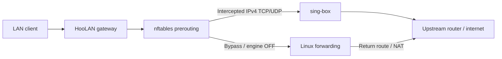

<div dir="rtl">

<p align="center">
  <picture>
    <source media="(prefers-color-scheme: dark)" srcset="internal/api/web/hoo-logo-dark.svg" />
    <source media="(prefers-color-scheme: light)" srcset="internal/api/web/hoo-logo-light.svg" />
    
  </picture>
</p>
<h1 align="center">HooLAN</h1>

<center>

**این متن توسط هوش مصنوعی ترجمه شده است و دیگر بروز نمی‌شود. لطفا برای اصطلاحات دقیق‌تر و بروزتر، به  متن <a href="README.md">انگلیسی</a> مراجعه فرمایید.**

</center>


<p align="center">
  <a href="#شروع-سریع">شروع سریع</a> · <a href="docs/installation.md">نصب</a> · <a href="docs/dashboard.md">داشبورد</a> · <a href="docs/routing.md">مسیریابی</a> · <a href="docs/dns-fa.md">DNS و FakeDNS</a> · <a href="docs/devices.md">دستگاه‌ها</a> · <a href="docs/troubleshooting.md">عیب‌یابی</a> · <a href="README.md">English</a>
</p>

HooLAN یک داشبورد وب برای مدیریت دروازهٔ پروکسی شفاف روی Debian است.
اشتراک اضافه کنید، مسیر اتصال هر دستگاه را انتخاب کنید، محدودیت سرعت بگذارید
و مصرف اینترنت را ببینید؛ همه از یک پنل. برنامه با یک فایل اجرایی Go و با کمک
sing-box و nftables اجرا می‌شود و رابط وب به مرحلهٔ ساخت جداگانه نیاز ندارد.

## امکانات

- **پیکربندی‌ها:** لینک دستی، کارت‌های اشتراک، حذف گره‌های کنارگذاشته‌شده توسط
  ارائه‌دهنده هنگام به‌روزرسانی، تست تأخیر و حذف گروهی، ویرایش، تست سرعت و QR.
- **زنجیرهٔ چندمرحله‌ای:** ترتیب قابل ویرایش گره‌ها، نسخه‌های مستقل از منابع و
  نگهداری نام اصلی هر مرحله.
- **توزیع بار:** پخش اتصال‌ها بین چند گره یا انتخاب بهترین تأخیر اندازه‌گیری‌شده
  با URLTest در sing-box.
- **کنترل دستگاه‌ها:** نام دلخواه، مسیر پیش‌فرض سراسری، مستقیم، گره، زنجیره یا گروه؛
  همراه با سقف مستقل ارسال و دریافت برای ترافیک مستقیم و پروکسی.
- **مسیریابی و DNS:** انتخاب resolver، پیش‌تنظیم ایران، مجموعه‌قواعد و قوانین سفارشی،
  با به‌روزرسانی دوره‌ای، روزانه یا هفتگی.
- **DNS و FakeDNS:** تفکیک DNS مستقیم و رمزگذاری‌شده، با امکان پاسخ IPv4 مجازی
  و نگاشت پایدار دامنه‌ها؛ شنود روی درگاه ۱۰۵۳. [راهنما](docs/dns-fa.md).
- **آمار مصرف:** مجموع مصرف و سهم مستقیم، گره‌ها و دستگاه‌ها، با مرتب‌سازی از طریق
  کلیک روی عنوان ستون‌ها. سهم‌ها از نمونه‌برداری اتصال‌ها تخمین زده می‌شوند.
- **عملیات:** لاگ زنده با SSE، اعلان تلگرام با پروکسی قابل انتخاب، پشتیبان‌گیری و
  بازیابی ZIP و اجرای سرویس با systemd.
- **رابط کاربری:** ورود با توکن، حالت روشن/تاریک، فارسی و انگلیسی و
  چیدمان راست‌به‌چپ؛ بدون نیاز به ساخت جداگانهٔ فرانت‌اند.

بک‌اند فقط از کتابخانهٔ استاندارد Go استفاده می‌کند. کتابخانهٔ نمایش QR هنگام نیاز
در مرورگر بارگذاری می‌شود؛ سایر فایل‌های داشبورد داخل فایل اجرایی قرار دارند.

## نحوهٔ کار

</div>



<div dir="rtl">

رهگیری فقط پس از تأیید مالکیت شنونده‌های TCP و UDP توسط موتور فعال می‌شود.
خاموش کردن موتور، رهگیری را حذف می‌کند و تنظیمات forwarding/NAT و محدودیت‌های
دستگاه‌ها را نگه می‌دارد. مسیریابی عادی میزبان باید مستقل تنظیم شده باشد؛ کلید
خاموش، مسیر بالادستی ایجاد نمی‌کند. اگر دستگاه‌ها از DNS در HooLAN با
درگاه ۱۰۵۳ استفاده می‌کنند، پیش از خاموش‌کردن یک resolver در دسترس برایشان تنظیم کنید. در حالت FakeDNS، پیش از خاموش‌کردن باید
upstream واقعی DNS را برگردانید و حافظهٔ نهان را پاک کنید؛
[راهنمای خاموش‌کردن](docs/dns-fa.md) را ببینید.

TPROXY در مرحلهٔ prerouting با اولویت `-150` اجرا می‌شود. بسته‌های علامت‌گذاری‌شده
با policy routing به سوکت محلی تحویل داده می‌شوند. موتور برای خروجی، اتصال جدیدی
باز می‌کند؛ خروجی آن نباید همان mark رهگیری ورودی را داشته باشد.

## شروع سریع

از Debian با رابط سیمی، IPv4 ثابت و مسیر پیش‌فرض به روتر
بالادستی استفاده کنید. sing-box باید پشتیبانی Clash API داشته باشد؛ پیکربندی
HooLAN برای sing-box 1.14 طراحی شده است. حداقل سطح زبان ماژول، Go 1.21 است؛ برای
ساخت از نسخهٔ پشتیبانی‌شدهٔ ابزار Go استفاده کنید.

از ریشهٔ مخزن، فایل اجرایی را برای میزبان دبیان خود بسازید:

</div>

```bash
CGO_ENABLED=0 go build -trimpath -ldflags='-s -w' -o hoolan ./cmd/server
```

<div dir="rtl">

سپس [راهنمای نصب](docs/installation.md) را برای نصب سرویس، تنظیم احراز هویت و
راه‌اندازی forwarding دنبال کنید. این راهنما دستورهای کامل برای میزبان دبیان تک‌رابطی با
UFW فعال و روش دسترسی به داشبورد محدودشده به loopback را دارد.

1. HooLAN را نصب و `HOOLAN_TOKEN` و `HOOLAN_CLASH_SECRET` را تنظیم کنید.
2. رابط LAN و مقادیر TPROXY را در `tproxy.conf` وارد کنید.
3. با موتور خاموش، دسترسی یک دستگاه آزمایشی به اینترنت از طریق میزبان دبیان را بررسی کنید.
4. سرویس `hoolan.service` را اجرا کنید، وارد پنل شوید و لینک یا اشتراک اضافه کنید.
5. یک خروجی را تست و انتخاب کنید، موتور را روشن کنید و سپس DHCP را برای استفاده
   از میزبان دبیان به‌عنوان دروازهٔ IPv4 دستگاه‌ها تنظیم کنید.

مسیر پیش‌فرض خود میزبان دبیان نباید به خودش اشاره کند. برای ثبات مسیر و محدودیت‌های هر
دستگاه، IP را در DHCP رزرو کنید. IPv6 به سیاست جداگانه نیاز دارد.

## مستندات

راهنماهای تخصصی زیر به انگلیسی هستند.

| راهنما | محتوا |
| --- | --- |
| [نصب](docs/installation.md) | ساخت، میزبان، systemd، احراز هویت و HTTPS |
| [داشبورد](docs/dashboard.md) | بخش‌ها، کنترل‌ها، لاگ، پوسته و زبان |
| [پیکربندی‌ها](docs/configurations.md) | اشتراک، ویرایش، زنجیره و عملیات گروهی |
| [توزیع بار](docs/load-balancing.md) | توزیع اتصال‌ها و بهترین تأخیر، رفتار و محدودیت‌ها |
| [DNS و FakeDNS](docs/dns-fa.md) | سرورها، نشانی‌های مجازی، راه‌اندازی و بازیابی |
| [مسیریابی](docs/routing.md) | DNS، پیش‌تنظیم ایران، قواعد و زمان‌بندی |
| [دستگاه‌ها](docs/devices.md) | Split Tunneling، محدودیت چهارگانه و مصرف |
| [یکپارچه‌سازی‌ها](docs/integrations.md) | تلگرام، پشتیبان، تست سرعت و QR |
| [API](docs/api.md) | احراز هویت، مسیرها، بدنهٔ درخواست و کارهای پس‌زمینه |
| [عیب‌یابی](docs/troubleshooting.md) | شبکه، ورود و خطاهای ارسال |
| [توسعه](docs/development.md) | معماری، تست‌ها، فایل‌های وب و مرزهای عملیاتی |

## فایل‌ها و تنظیمات

| مسیر یا تنظیم | کاربرد |
| --- | --- |
| `/opt/hoolan/hoolan` | فایل اجرایی Go |
| `/opt/hoolan/scripts/tproxy/` | اسکریپت‌ها، قالب فایروال و `tproxy.conf` |
| `/etc/hoolan/env` | توکن‌ها و متغیر اختیاری `HOOLAN_SUBS` |
| `/var/lib/hoolan/nodes.json` | پیکربندی، نسخه‌های مستقل و سنجش سلامت |
| `/var/lib/hoolan/state.json` | انتخاب، دستگاه‌ها، قواعد، مصرف و اعلان‌ها |
| `/etc/hoolan/singbox/config.json` | پیکربندی تولیدشدهٔ sing-box |
| `/var/lib/hoolan/cache.db` | کش موتور |
| `/run/hoolan/` | قفل‌ها و اطلاعات اجرایی رهگیری |
| `hoolan.service` | واحد systemd |

همهٔ گزینه‌های خط فرمان با `./hoolan -h` نمایش داده می‌شوند. مسیر فایل مجموعه‌قواعد
و زمان به‌روزرسانی در تنظیمات دیده می‌شود. نسخهٔ پشتیبان شامل اطلاعات محرمانه است؛
آن را خصوصی نگه دارید.

## محدودهٔ عملکرد

HooLAN ترافیک IPv4 عبوری از میزبان دبیان را مدیریت می‌کند. ترافیک هم‌شبکه‌ای که مسیر دیگری
می‌گیرد قابل اندازه‌گیری یا محدودسازی نیست. محدودیت سرعت از نوع policing با حذف
بسته است، نه صف‌بندی ترافیک. توزیع اتصال‌ها سرعت یک دانلود را از چند پروکسی جمع
نمی‌کند و بار سرور راه‌دور را نمی‌سنجد. مصرف، بایت‌های payload موتور است و forwarding
هنگام خاموش بودن موتور را شامل نمی‌شود؛ اتصال‌های کوتاه ممکن است در نمونه‌برداری
ثبت نشوند.

دروازه را روی میزبان اصلی اجرا کنید. Clash API را محلی نگه دارید، پشت HTTPS
هدر Host عمومی را حفظ کنید و forwarding را در فایروال فعال میزبان تنظیم کنید.
پیش از تغییر گستردهٔ سیاست‌های INPUT/FORWARD، [عیب‌یابی](docs/troubleshooting.md)
را بخوانید.

</div>
