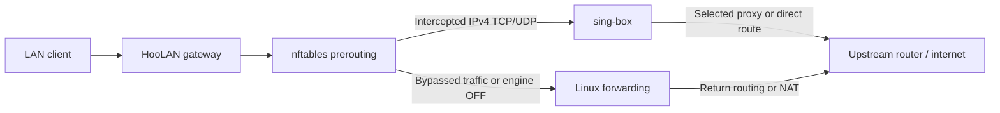
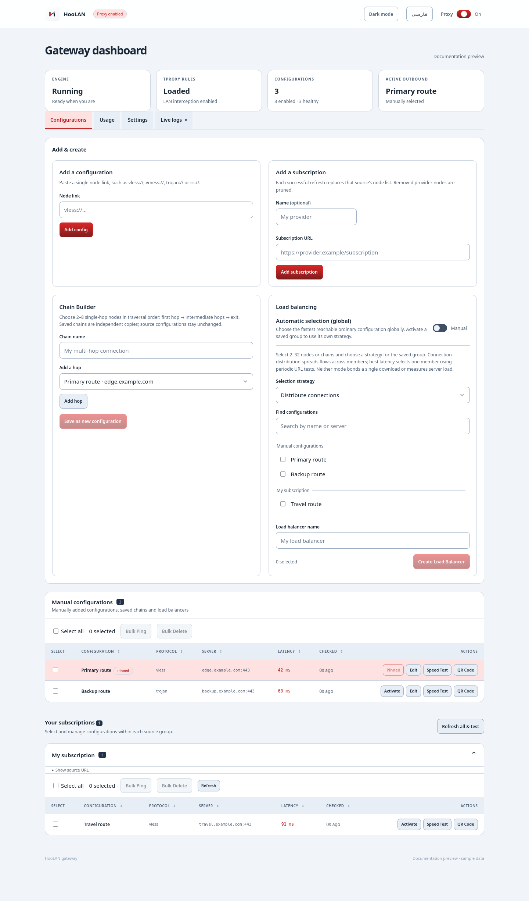

<p align="center">
  <picture>
    <source media="(prefers-color-scheme: dark)" srcset="internal/api/web/hoo-logo-dark.svg" />
    <source media="(prefers-color-scheme: light)" srcset="internal/api/web/hoo-logo-light.svg" />
    
  </picture>
</p>
<h1 align="center">HooLAN</h1>

<p align="center">
  <a href="#installation">Installation</a> · <a href="docs/dashboard.md">Dashboard</a> · <a href="docs/routing.md">Routing</a> · <a href="#screenshots">Screenshots</a> · <a href="docs/dns.md">DNS &amp; FakeDNS</a> · <a href="docs/devices.md">Devices</a> · <a href="docs/troubleshooting.md">Troubleshooting</a> · <a href="README-fa.md"><s>Persian</s></a>
</p>

HooLAN is a web dashboard for managing a transparent proxy gateway on Debian.
Add proxy subscriptions, choose a route for each device, set speed limits and
monitor usage from one place. It runs as a single Go binary with sing-box and
nftables, with no frontend build step.

## Features

- **Configurations:** manual links and subscription cards, strict refresh pruning,
  latency tests, deletion, editing, speed tests and QR sharing.
- **Multi-hop chains:** ordered, editable paths with independent node snapshots.
- **Load balancing:** distribute connections, or select
  the best measured latency.
- **Device control:** persistent aliases, Global Default/Direct/node/chain/group
  routing and separate proxy/direct upload/download limits.
- **Routing & DNS:** split DNS, Iran preset, custom rule sets and
  routing rules.
- **DNS & FakeDNS:** separate direct and encrypted DNS, with optional FakeDNS.
- **Usage:** total, direct, per-node and per-device counters.
- **Operations:** live SSE logs, Telegram notifications with a selectable proxy,
  ZIP backup/restore and systemd supervision.
- **Interface:** token login, dark/light themes and English/Persian
  localization with RTL layout.

## How it works



Routing happens in two stages. **nftables** intercepts eligible LAN IPv4 TCP/UDP;
local/private destinations and excluded traffic use ordinary host routing.
**sing-box** handles DNS and safety rules first, then evaluates custom routing
rules, custom rule sets and the Iran preset. The first matching action either:
connect directly, use the globally selected proxy, or reject. Remaining traffic
uses its device assignment or the global default. Device assignments do not
override earlier bypass or rejection rules.

Chains follow their saved hop sequence. Load-balanced groups either distribute
connections or select the best measured latency. DNS listens on TCP/UDP port
**1053**, with separate direct and tunneled resolvers and optional FakeDNS.

See the [routing guide](docs/routing.md) for the complete decision order,
configuration examples, updates and diagnostics.

## Installation

These steps are for a fresh installation on Debian. For an existing installation,
follow [Updating an installation](docs/installation.md#updating-an-installation).

### 1. Prepare the host

Use a Debian host with systemd, root access, a wired LAN interface and a static
IPv4 address. Its default route must point to your upstream router.
Install a maintained Go toolchain and
[sing-box with Clash API support](https://sing-box.sagernet.org/installation/package-manager/).
HooLAN targets sing-box 1.14; the Go module declares Go 1.21 as its language baseline.

Install the host utilities and check your tools and default route:

```bash
sudo apt-get update
sudo apt-get install nftables iproute2 procps util-linux ca-certificates curl openssl python3
go version
sing-box version
ip -4 route show default
```

HooLAN starts and manages sing-box itself. If a standalone sing-box service is
running, stop and disable it before starting HooLAN to avoid listener conflicts.

The examples below use `eth0`, host address `192.168.3.5` and LAN subnet
`192.168.3.0/24`. Replace these with your own values.

### 2. Build and install HooLAN

Run these commands from the repository root on your Debian host:

```bash
CGO_ENABLED=0 go build -trimpath -ldflags='-s -w' -o hoolan ./cmd/server
sudo install -Dm755 hoolan /opt/hoolan/hoolan
for script in apply.sh remove.sh diagnose.sh install-router.sh; do
  sudo install -Dm755 "scripts/tproxy/$script" "/opt/hoolan/scripts/tproxy/$script"
done
sudo install -Dm644 scripts/tproxy/tproxy.nft.template /opt/hoolan/scripts/tproxy/tproxy.nft.template
sudo install -Dm600 scripts/tproxy/tproxy.conf /opt/hoolan/scripts/tproxy/tproxy.conf
sudo install -d -m700 /var/lib/hoolan /etc/hoolan/singbox
sudo install -m600 deploy/hoolan.env.example /etc/hoolan/env
```

The build includes the dashboard; no frontend build step is needed.

### 3. Configure authentication and the LAN interface

Generate two independent secrets by running this command twice:

```bash
openssl rand -hex 32
```

Edit the environment file:

```bash
sudoedit /etc/hoolan/env
```

Set `HOOLAN_TOKEN` to one secret for dashboard login and `HOOLAN_CLASH_SECRET`
to the other for engine control. Replace both placeholder values. Subscriptions
can be added later through the dashboard.

Edit the firewall configuration:

```bash
sudoedit /opt/hoolan/scripts/tproxy/tproxy.conf
```

Set `LAN_IF` to your LAN interface and `PI_LAN_IP` to the Debian host's static
LAN address. Keep `TPROXY_PORT="7892"` to match the supplied service unit.
See the [configuration reference](docs/installation.md#install-the-service-files)
for the remaining mark, routing table and interface options.

### 4. Configure gateway forwarding

Clients must have internet access through the Debian host even when the proxy
engine is OFF. Configure IPv4 forwarding, an upstream default route, firewall
permissions and either a return route or scoped NAT.

For a **single-interface host with UFW already active**, run the supplied router
installer after substituting your interface and subnet:

```bash
sudo env LAN_IF=eth0 LAN_CIDR=192.168.3.0/24 TPROXY_FWMARK=0x1 \
  bash /opt/hoolan/scripts/tproxy/install-router.sh
```

This configures forwarding, scoped MASQUERADE and TPROXY input permissions,
with backups of the UFW files. The mark must match `tproxy.conf`. For other
firewalls or a two-interface setup, configure the equivalent rules through your
firewall; see [host routing](docs/installation.md#establish-routing-before-interception).

Set one test client's IPv4 gateway to the Debian host and verify internet
access before enabling interception or changing DHCP for the whole LAN.

### 5. Start the service

```bash
sudo install -m644 deploy/hoolan.service /etc/systemd/system/hoolan.service
sudo systemctl daemon-reload
sudo systemctl enable --now hoolan
```

### 6. Open the dashboard

The supplied service listens on `127.0.0.1:8080`. From your workstation, open
an SSH tunnel, replacing the username and host address:

```bash
ssh -N -L 8080:127.0.0.1:8080 user@192.168.3.5
```

Open [http://127.0.0.1:8080/](http://127.0.0.1:8080/) and sign in with your
`HOOLAN_TOKEN`. Add a configuration or subscription, test and select an outbound,
then enable the proxy engine. Verify the test client's connection before setting
DHCP's IPv4 gateway option to the Debian host for the rest of the LAN.

Reserve client addresses in DHCP for stable device routing and limits. Keep a
working DNS resolver configured; HooLAN's DNS listener uses port **1053** and is
configured separately under [DNS & FakeDNS](docs/dns.md). IPv6 needs a separate
routing policy. For access through a domain, follow the
[HTTPS setup](docs/installation.md#https-access).

## Screenshots

Current dashboard views with illustrative sample data.

### Configurations

<picture>
  <source media="(prefers-color-scheme: dark)" srcset="docs/images/configurations-dark.png" />
  <source media="(prefers-color-scheme: light)" srcset="docs/images/configurations-light.png" />
  
</picture>

### Internet usage and device routing

<picture>
  <source media="(prefers-color-scheme: dark)" srcset="docs/images/usage-dark.png" />
  <source media="(prefers-color-scheme: light)" srcset="docs/images/usage-light.png" />
  
</picture>

### Routing & DNS

<picture>
  <source media="(prefers-color-scheme: dark)" srcset="docs/images/routing-dns-dark.png" />
  <source media="(prefers-color-scheme: light)" srcset="docs/images/routing-dns-light.png" />
  
</picture>

See the [routing guide](docs/routing.md) for policy configuration and the
[dashboard guide](docs/dashboard.md) for the other controls.

## Documentation

| Guide | Contents |
| --- | --- |
| [Installation](docs/installation.md) | Build, host setup, systemd, authentication and HTTPS |
| [Dashboard](docs/dashboard.md) | Navigation, controls, logs, themes and language |
| [Configurations](docs/configurations.md) | Subscriptions, editing, chains and batch actions |
| [Load balancing](docs/load-balancing.md) | Distribution versus best latency, behavior and limits |
| [DNS & FakeDNS](docs/dns.md) | DNS servers, virtual addresses, setup and recovery |
| [Routing](docs/routing.md) | DNS, Iran preset, custom rules and update schedules |
| [Devices](docs/devices.md) | Split tunneling, four-way speed limits and usage |
| [Integrations](docs/integrations.md) | Telegram, backups, throughput tests and QR sharing |
| [API](docs/api.md) | Authentication, routes, payloads and background jobs |
| [Troubleshooting](docs/troubleshooting.md) | Network diagnostics, login and delivery errors |
| [Development](docs/development.md) | Architecture, tests, assets and operational boundaries |

## Files and settings

| Path or setting | Purpose |
| --- | --- |
| `/opt/hoolan/hoolan` | Go executable |
| `/opt/hoolan/scripts/tproxy/` | Firewall helpers, template and `tproxy.conf` |
| `/etc/hoolan/env` | `HOOLAN_TOKEN`, `HOOLAN_CLASH_SECRET`, optional `HOOLAN_SUBS` |
| `/var/lib/hoolan/nodes.json` | Configurations, snapshots and health measurements |
| `/var/lib/hoolan/state.json` | Selection, devices, rules, usage and notification settings |
| `/etc/hoolan/singbox/config.json` | Generated sing-box configuration |
| `/var/lib/hoolan/cache.db` | sing-box cache |
| `/run/hoolan/` | Runtime locks and interception metadata |
| `hoolan.service` | systemd unit |

Run `./hoolan -h` for command-line options. Rule-set filesystem paths and update
timestamps appear in Settings. Backups contain secrets; store them privately.

## Scope

HooLAN manages IPv4 traffic that crosses the Debian host. Same-subnet traffic taking
another path cannot be measured or limited. Device limits are packet-drop
policers, not queued traffic shaping. Connection distribution cannot combine
one download across proxies and does not measure remote server load. Usage
counts engine payload bytes and omits raw forwarding while the engine is OFF;
short connections can be missed by attribution sampling.

Run the gateway on bare metal. Keep the Clash API local, preserve the dashboard's
public Host header behind HTTPS, and configure forwarding in the host's active
firewall. See [troubleshooting](docs/troubleshooting.md) before altering broad
INPUT/FORWARD policies.
