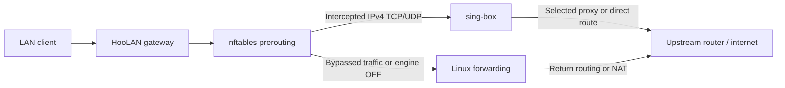

# HooLAN

<picture>
  <source media="(prefers-color-scheme: dark)" srcset="internal/api/web/hoo-logo-dark.svg" />
  <source media="(prefers-color-scheme: light)" srcset="internal/api/web/hoo-logo-light.svg" />
  
</picture>

**Your LAN, with control over every connection.**

[Quick start](#quick-start) · [Installation](docs/installation.md) · [Dashboard](docs/dashboard.md) · [Routing](docs/routing.md) · [Split DNS](docs/split-dns.md) · [FakeDNS](docs/fakedns.md) · [Devices](docs/devices.md) · [Troubleshooting](docs/troubleshooting.md) · [فارسی](README-fa.md)

HooLAN turns a Debian host into a transparent IPv4 proxy gateway. Manage
subscriptions, build multi-hop connections, assign routes to devices and set
speed limits from a lightweight dashboard. A single Go binary serves the UI
and API, supervises sing-box and manages nftables interception.

## Features

- **Configurations:** manual links and subscription cards, strict refresh pruning,
  bulk latency tests, bulk deletion, editing, speed tests and QR sharing.
- **Multi-hop chains:** ordered, editable paths with independent node snapshots
  and preserved source names.
- **Load balancing:** distribute connections across multiple nodes, or select
  the best measured latency with sing-box URLTest.
- **Device control:** persistent aliases, Global Default/Direct/node/chain/group
  routing and separate proxy/direct upload/download limits.
- **Routing & DNS:** configurable resolver, Iran preset, custom rule sets and
  routing rules, with interval, daily or weekly updates.
- **Split DNS:** AdGuard upstream on port 1053, direct DNS for bypass rules and
  HTTPS DNS through the active proxy for other queries.
- **FakeDNS:** opt-in synthetic IPv4 DNS, encrypted real lookups, persistent
  mappings and integration with Docker AdGuard.
- **Usage:** total, direct, per-node and per-device counters, sorted by upload
  or download. Attribution is estimated from connection samples.
- **Operations:** live SSE logs, Telegram notifications with a selectable proxy,
  ZIP backup/restore and systemd supervision.
- **Interface:** token login, red accents, dark/light themes and English/Persian
  localization with RTL layout. No frontend build step.

The backend uses only the Go standard library. QR rendering loads a pinned
browser library on demand; the rest of the dashboard's assets are embedded.

## How it works



HooLAN enables interception only after the engine owns the required TCP and UDP
listeners. Disabling the engine removes interception while preserving the
router's forwarding/NAT setup and device limits. Normal forwarding must be
configured independently; an OFF toggle cannot create an upstream route.
If AdGuard uses HooLAN on port 1053, restore its normal upstream before OFF.
With FakeDNS enabled, restore real DNS and clear downstream caches before OFF;
see the [FakeDNS shutdown procedure](docs/fakedns.md#cache-shutdown-and-recovery).

TPROXY runs at prerouting priority `-150`. Marked packets use policy routing
for local socket delivery. The proxy engine opens its own outbound connections;
its egress must not use the interception mark.

## Quick start

Use Debian Linux with a wired interface, a static LAN IPv4
address and an upstream default route. Install an upstream sing-box build with
Clash API support; the configuration targets sing-box 1.14. The module declares
Go 1.21 as its language baseline; use a maintained Go toolchain to build.

From the repository root, build an executable for your Debian host:

```bash
CGO_ENABLED=0 go build -trimpath -ldflags='-s -w' -o hoolan ./cmd/server
```

Then follow the [installation guide](docs/installation.md) to install the
service, configure authentication and establish forwarding. It includes exact
commands for a single-interface Debian host with an active UFW firewall and instructions
for accessing the loopback-bound dashboard.

1. Install HooLAN and set `HOOLAN_TOKEN` and `HOOLAN_CLASH_SECRET`.
2. Set the LAN interface and TPROXY values in `tproxy.conf`.
3. Verify a test client can reach the internet through the Debian host with the engine OFF.
4. Start `hoolan.service`, sign in and add a configuration or subscription.
5. Test/select an outbound, enable the engine, then configure DHCP clients to
   use the Debian host as their IPv4 gateway.

Do not point the Debian host's own default route back to itself. Reserve client addresses
in DHCP for stable device routing and limits. IPv6 needs a separate policy.

## Documentation

| Guide | Contents |
| --- | --- |
| [Installation](docs/installation.md) | Build, host setup, systemd, authentication and HTTPS |
| [Dashboard](docs/dashboard.md) | Navigation, controls, logs, themes and language |
| [Configurations](docs/configurations.md) | Subscriptions, editing, chains and batch actions |
| [Load balancing](docs/load-balancing.md) | Distribution versus best latency, behavior and limits |
| [Split DNS](docs/split-dns.md) | AdGuard, direct SmartDNS and tunneled DoH |
| [FakeDNS](docs/fakedns.md) | Synthetic DNS, AdGuard setup and cache recovery |
| [Routing](docs/routing.md) | DNS, Iran preset, custom rules and update schedules |
| [Devices](docs/devices.md) | Split tunneling, four-way speed limits and usage |
| [Integrations](docs/integrations.md) | Telegram, backups, throughput tests and QR sharing |
| [API](docs/api.md) | Authentication, routes, payloads and background jobs |
| [Troubleshooting](docs/troubleshooting.md) | Network diagnostics, login and delivery errors |
| [Development](docs/development.md) | Architecture, tests, assets and operational boundaries |

## Files and settings

| Path or setting | Purpose |
| --- | --- |
| `/opt/hoolan/hoolan` | Go executable |
| `/opt/hoolan/scripts/tproxy/` | Firewall helpers, template and `tproxy.conf` |
| `/etc/hoolan/env` | `HOOLAN_TOKEN`, `HOOLAN_CLASH_SECRET`, optional `HOOLAN_SUBS` |
| `/var/lib/hoolan/nodes.json` | Configurations, snapshots and health measurements |
| `/var/lib/hoolan/state.json` | Selection, devices, rules, usage and notification settings |
| `/etc/hoolan/singbox/config.json` | Generated sing-box configuration |
| `/var/lib/hoolan/cache.db` | sing-box cache |
| `/run/hoolan/` | Runtime locks and interception metadata |
| `hoolan.service` | systemd unit |

Run `./hoolan -h` for command-line options. Rule-set filesystem paths and update
timestamps appear in Settings. Backups contain secrets; store them privately.

## Scope

HooLAN manages IPv4 traffic that crosses the Debian host. Same-subnet traffic taking
another path cannot be measured or limited. Device limits are packet-drop
policers, not queued traffic shaping. Connection distribution cannot combine
one download across proxies and does not measure remote server load. Usage
counts engine payload bytes and omits raw forwarding while the engine is OFF;
short connections can be missed by attribution sampling.

Run the gateway on bare metal. Keep the Clash API local, preserve the dashboard's
public Host header behind HTTPS, and configure forwarding in the host's active
firewall. See [troubleshooting](docs/troubleshooting.md) before altering broad
INPUT/FORWARD policies.
