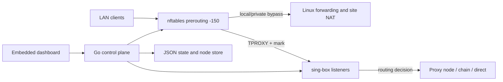

# HooLAN

HooLAN keeps the existing `proxy-manager` binary, systemd service, file paths and
`PROXY_MANAGER_*` environment variables for installation compatibility.

The dashboard groups all creation forms in **Configurations**, with a searchable
node picker inside the load balancer form. **Usage** sorts nodes and devices by
most downloaded or uploaded and shows saved speed limits beside each device's
**Settings** button. Zero-usage nodes remain hidden. **Settings** groups automatic
selection, DNS and routing rules under **Routing & DNS**, followed by Telegram
notifications and Backup & restore.


[فارسی](README-fa.md) · [Review and cleanup notes](docs/consolidation-review.md)

A transparent IPv4 gateway for a Raspberry Pi or Linux host. A single Go binary
serves the dashboard, manages configuration and supervises **sing-box**;
**nftables TPROXY** intercepts LAN traffic without installing proxy software on
each device. The dashboard is embedded Vanilla JS/HTML/CSS, with no frontend
build step. The Go module has **no external dependencies**.

## Features

- **Token-based Web UI:** login with `PROXY_MANAGER_TOKEN`, HttpOnly/SameSite
  sessions, CSRF protection, login throttling and bearer authentication for API clients.
- **Configuration management:** subscriptions and a separate manual group in one
  Configurations tab, collapsible cards, selected-node bulk ping/delete, manual
  editing and strict subscription synchronization. Successful refreshes prune
  orphaned provider nodes while preserving other sources and manual ownership.
- **Multi-hop Chaining:** create and edit ordered 2–8-hop chains. Saved chains
  use independent snapshots of their source configurations.
- **Active-Active Load Balancing:** group 2–32 nodes/chains. nftables hashes each
  connection to a separate sing-box TPROXY listener; concurrent connections use
  multiple members. This works with upstream sing-box, without a native
  `loadbalance` outbound, single-download bonding or automatic failed-member removal.
- **Per-Device Split Tunneling:** assign a client IP to Global Default, Direct,
  a node, a chain or a load balancer. Device names and assignments persist.
- **Per-Device QoS Rate Limiting:** independent Proxy Upload/Download and Direct
  Upload/Download caps, edited in a device modal. Zero/blank means unlimited for
  that class; see the classification caveat below. Direct policing survives OFF.
- **Routing and DNS:** editable Iran bypass, custom domain/CIDR rules and compiled
  GeoIP/geosite `.srs` sources; manual, interval, daily or weekly updates with
  time/timezone settings, filesystem paths and update status.
- **Usage tab:** cumulative engine traffic, nonzero node usage and named LAN
  devices. Per-device/node/direct attribution is sampled, not billing-grade.
- **Live SSE Logs:** pause/resume, bounded replay, credential redaction and slow
  subscriber handling. Service and sing-box logs also go to journald.
- **Dark/Light and Persian/English UI:** persisted browser preferences and RTL layout.
- **Operations:** Telegram alerts with direct/proxy delivery and a test button;
  ZIP backup/restore; real download speed tests through a selected node; mobile QR sharing.

Supported node links: `vless://`, `vmess://`, `trojan://`, `ss://`,
`hysteria2://` / `hy2://`, with supported TCP/WS/gRPC/HTTP, TLS and Reality options.
QR rendering alone loads a small pinned client-side CDN library on demand; the
share link is rendered in the browser, with a copy-link fallback.

## Architecture and operating limits



The Pi must have a stable LAN address and its **own default route via the upstream
router**. DHCP gives clients the Pi's address as their gateway. First make the
Pi work as an ordinary router with the proxy OFF; then enable interception.

On enable, the manager renders/checks config, starts sing-box, verifies ownership
of **every IPv4 TCP and UDP wildcard listener**, then installs interception and
policy routing. The default packet mark `0x1` selects table `100`, whose local
route delivers intercepted traffic through `lo`. Stopping removes interception
before stopping the engine. Crash cleanup attempts the same recovery; it cannot
guarantee connectivity if firewall cleanup fails or ordinary forwarding is absent.

Local/Pi service traffic bypasses interception before Docker DNAT. Normal
sing-box egress consists of new Pi-originated sockets using the host default
route; the TPROXY mark must not be reused as their outbound routing mark.
Forwarded client traffic instead needs firewall permission and a valid return
route, or scoped SNAT/MASQUERADE. **OFF does not remove router/NAT or QoS settings.**

Routing precedence is: listener loop protection → sniff → intercepted DNS
forwarding → private destinations → configured custom/Iran rules → device or
balanced-listener routing → global default. **DNS Hijacking is not enabled:**
intercepted DNS is forwarded to its original resolver through the selected proxy.
Local AdGuard traffic bypasses interception. The DNS setting changes sing-box's
resolver; it does not reconfigure LAN DHCP DNS or AdGuard.

QoS uses packet-drop policers, not queued traffic shaping. Upload runs at -149,
after interception but before userspace; download runs at postrouting 99, before
SNAT. The interception mark does **not** reveal Iran/direct decisions inside
sing-box. One-second Clash connection samples populate expiring tuple sets.
Until classified, a connection uses the stricter nonzero cap for that direction;
short flows, missing samples and busy operations may prolong that fallback.
An unlimited class may therefore be temporarily limited by the other class's
cap. Forwarded traffic uses Direct immediately. See [QoS details](docs/load-balancing-qos.md).

This is an **IPv4, single-gateway** design. IPv6 can bypass it; configure LAN
IPv6 deliberately. Same-subnet traffic that never crosses the Pi cannot be
limited. Keep per-device IPs stable with DHCP reservations. Usage excludes raw
forwarding while OFF, protocol overhead and traffic outside sing-box; short
connections can be missed. Chains and load balancers are not HA for the Pi itself.

## Requirements

- Raspberry Pi OS / Debian Linux, preferably wired Ethernet and a static IPv4 address.
- Upstream **sing-box 1.14-compatible** configuration, with Clash API support;
  validate a new release before upgrading. Install from the
  [official package instructions](https://sing-box.sagernet.org/installation/package-manager/).
- `bash`, `nftables`, `iproute2`, `procps`, `util-linux` (`flock`), systemd and root
  access for firewall/process management. The optional UFW router installer also
  needs active UFW and Python 3.
- A Go toolchain supporting the module's Go 1.21 baseline, or an ARM binary built
  elsewhere. Use a maintained Go release for deployment.

Examples use Pi `192.168.3.5`, router `192.168.3.1`, LAN `192.168.3.0/24`,
interface `eth0`, dashboard port `8080`, TPROXY `7892`, Clash `127.0.0.1:9090`.
Replace these with your site values. The LAN CIDRs used for interception are
read from live interface addresses.

## Installation

### 1. Prepare the host and build

```bash
sudo apt-get update
sudo apt-get install nftables iproute2 procps util-linux ca-certificates curl
sing-box version
ip -4 route show default
```

Install sing-box using the official instructions above. Disable its standalone
unit if it is installed: this manager must own the sing-box instance.

```bash
sudo systemctl disable --now sing-box
# From the repository root; no npm or Go dependencies to install.
CGO_ENABLED=0 GOOS=linux GOARCH=arm64 \
  go build -trimpath -ldflags='-s -w' -o proxy-manager ./cmd/server
# For a 32-bit Pi userland: GOARCH=arm GOARM=7 instead of GOARCH=arm64.
```

### 2. Install files and configure the site

The following is for a **first installation**. For an existing gateway, use the
upgrade section so you preserve its environment, `tproxy.conf` and state.

```bash
sudo install -Dm755 proxy-manager /opt/proxy-manager/proxy-manager
for script in apply.sh remove.sh diagnose.sh install-router.sh; do
  sudo install -Dm755 "scripts/tproxy/$script" "/opt/proxy-manager/scripts/tproxy/$script"
done
sudo install -Dm644 scripts/tproxy/tproxy.nft.template /opt/proxy-manager/scripts/tproxy/tproxy.nft.template
sudo install -Dm600 scripts/tproxy/tproxy.conf /opt/proxy-manager/scripts/tproxy/tproxy.conf
sudo install -d -m700 /var/lib/proxy-manager /etc/proxy-manager/singbox
sudo install -m600 deploy/proxy-manager.env.example /etc/proxy-manager/env
sudoedit /etc/proxy-manager/env
sudoedit /opt/proxy-manager/scripts/tproxy/tproxy.conf
```

Replace both example secrets with different long random values. The Web UI token
is the login credential; the Clash secret protects the separate local control API.
Subscriptions may be added entirely through the dashboard.

`tproxy.conf` uses literal assignments; do not put inline comments after values:

```bash
LAN_IF="eth0"
TPROXY_PORT="7892"
TPROXY_FWMARK="0x1"
TPROXY_TABLE="100"
TPROXY_RULE_PRIORITY="10000"
PI_LAN_IP="192.168.3.5"
SELF_ORIGIN_NETS=""
WG_RP_FILTER="yes"
```

Match `TPROXY_PORT` to the service flag. Reserve the mark, table and rule priority
for this gateway. Load-balanced groups allocate additional TPROXY ports; the
service checks them before enabling interception.

### 3. Establish forwarding with the engine OFF

The supported convenience installer is for an **already active UFW firewall**
and a single-interface gateway:

```bash
sudo env LAN_IF=eth0 LAN_CIDR=192.168.3.0/24 TPROXY_FWMARK=0x1 \
  bash /opt/proxy-manager/scripts/tproxy/install-router.sh
```

It backs up UFW files and persists scoped forwarding, marked TCP/UDP INPUT
exceptions, MASQUERADE, IPv4 forwarding, disabled redirects and reverse-path
settings. Pass the same mark as `tproxy.conf`. Do not use it unchanged for a
two-interface gateway or another firewall manager.

For another firewall, configure those functions through its existing rules and
persistence mechanism. A return route can replace SNAT. Inspect all INPUT and
FORWARD chains: an accept in one nft base chain cannot cancel a drop in another.
Test a client with the Pi as gateway **while OFF** before changing DHCP for everyone.

### 4. Start the service and sign in

```bash
sudo install -m644 deploy/proxy-manager.service /etc/systemd/system/proxy-manager.service
sudo systemctl daemon-reload
sudo systemctl enable --now proxy-manager
sudo journalctl -u proxy-manager -n 80 --no-pager
```

The supplied unit binds the dashboard to loopback. From your workstation:

```bash
ssh -N -L 8080:127.0.0.1:8080 pi@192.168.3.5
```

Open `http://127.0.0.1:8080/`, sign in with `PROXY_MANAGER_TOKEN`, add a
subscription/manual link, select a configuration and enable the engine. The
Configurations, Usage, Settings and Live Logs tabs provide the remaining controls.
Manual mode omits background URLTest sweeps; explicit tests remain available.
Telegram's optional health monitor checks only the active node.

Then set the router's DHCP gateway option to the Pi and renew client leases.
On OpenWrt, an example DHCP option is `3,192.168.3.5`; use `6,192.168.3.5` for
DNS only if a resolver actually listens there. Never point the Pi's own gateway
back to itself. Configure IPv6 RA/DHCPv6 consistently with the IPv4-only scope.

### HTTPS reverse proxy

Keep the dashboard behind a trusted HTTPS reverse proxy for remote access. In
its upstream location, preserve the public host and disable SSE buffering:

```nginx
proxy_pass http://127.0.0.1:8080;
proxy_set_header Host $http_host;
proxy_set_header X-Forwarded-Proto $scheme;
proxy_http_version 1.1;
proxy_buffering off;
proxy_read_timeout 75s;
```

Add `-secure-cookies` to the unit's `ExecStart` for HTTPS-only browser access,
then daemon-reload/restart. The application checks the public Origin against
Host and the configured HTTPS expectation; it does not blindly trust forwarded
headers. A Dockerized Nginx Proxy Manager cannot reach the host's loopback as
its own `127.0.0.1`: use a reachable host bind/address and restrict that listener
to trusted proxy sources. Keep the Clash API loopback-only.

## Configuration, persistence and backups

Run `proxy-manager -h` for every option. Common settings:

| Flag | Default | Purpose |
| --- | --- | --- |
| `-listen` | `:8080` (shipped unit: `127.0.0.1:8080`) | Dashboard/API listener |
| `-token` | `PROXY_MANAGER_TOKEN` | Web login and API token; empty disables authentication |
| `-secure-cookies` | `false` | HTTPS browser cookies and expected public scheme |
| `-scripts` | probed directories | Firewall scripts and site config |
| `-sing-box`, `-tproxy-port` | `sing-box`, `7892` | Engine executable and base listener |
| `-clash-api`, `-clash-secret` | `127.0.0.1:9090`, `PROXY_MANAGER_CLASH_SECRET` | Local control/usage API |
| `-sub` | `PROXY_MANAGER_SUBS` if not supplied | Initial URLs/files; repeatable |
| `-probe-concurrency`, `-refresh-timeout` | `4`, `10m` | Probe workers and job budget |
| `-probe-url` | `http://cp.cloudflare.com/generate_204` | Latency target |
| `-log-level` | `info` | debug/info/warn/error |
| `-expose-credentials` | `false` | Include node secrets in ordinary listings |
| `-no-restore` | `false` | Skip startup state restoration; not a firewall cleanup command |

| Default path | Contents |
| --- | --- |
| `/var/lib/proxy-manager/nodes.json` (`-store`) | Nodes, private chain/member snapshots and health |
| `/var/lib/proxy-manager/state.json` (`-state`) | Selection, subscriptions, aliases/routes/QoS, rules, schedules, usage, Telegram settings |
| `/etc/proxy-manager/singbox/config.json` (`-config`) | Generated engine configuration; edit through the manager |
| `/var/lib/proxy-manager/cache.db` (`-cache`) | sing-box runtime cache |
| `/opt/proxy-manager/scripts/tproxy/tproxy.conf` | Administrator-owned firewall configuration |
| `/run/proxy-manager/` | Generated nft batch, lock and interception routing metadata |

Rule-set paths and last update/next due time appear in Settings. Scheduled
updates run even when the proxy is OFF. The actual rule file paths are also
returned by `/api/rules`.

Settings → Backup downloads `nodes.json`, `state.json`, `tproxy.conf` and
`devices.json`. The archive contains credentials and the Telegram token: store
it privately. Restore validates filenames, sizes, references and configuration
before replacing settings and applying the saved ON/OFF intent. Binary files,
systemd units, UFW/NAT rules, caches and downloaded `.srs` payloads are not in
the ZIP; preserve those separately or redownload rule sets after migration.

## API

Use `Authorization: Bearer <token>` for automation. Browser sessions use an
HttpOnly cookie plus `X-CSRF-Token` for mutations. `/healthz` is public liveness,
not proof of functioning LAN routing. Tokens are not stored in browser localStorage.

| Routes | Purpose |
| --- | --- |
| `GET /api/status`, `GET /api/nodes` | Status, selection and configurations |
| `POST /api/proxy/toggle`, `POST /api/proxy/select` | Enable/disable and select |
| `POST /api/nodes`, `PUT /api/nodes/edit` | Add link / edit manual node |
| `GET/POST /api/subscriptions`, `POST /api/subscriptions/refresh` | Subscription management |
| `POST /api/nodes/test`, `POST /api/nodes/delete` | Selected `node_ids` arrays |
| `GET/POST/PUT /api/chains`, `POST /api/load-balancers` | Chains and saved distribution groups |
| `GET /api/usage`, `PUT /api/devices` | Statistics, alias, outbound and four QoS fields |
| `GET/PUT /api/settings`, `GET/PUT /api/rules`, `POST /api/rules/update` | DNS/routing and schedules |
| `GET /api/logs` | SSE stream, replay via Last-Event-ID |
| `GET/PUT /api/telegram`, `POST /api/telegram/test` | Notifications |
| `GET /api/backup`, `POST /api/restore` | ZIP export/import |
| `POST /api/nodes/speed`, `POST /api/nodes/share` | Throughput job / mobile share link |

Example request (set `TOKEN` locally):

```bash
curl --fail-with-body -H "Authorization: Bearer $TOKEN" \
  -H 'Content-Type: application/json' -X PUT http://127.0.0.1:8080/api/devices \
  -d '{"ip":"192.168.3.141","alias":"Phone","node_id":"direct","qos":{"proxy_upload_mbps":2,"proxy_download_mbps":10,"direct_upload_mbps":4,"direct_download_mbps":20}}'
```

An omitted top-level device field stays unchanged. An included `qos` object
replaces all four values; `{}` clears them. Legacy single numeric caps migrate
to the same value in all four fields. Long-running refresh/test/restore actions
report job progress through status; `409` usually means another operation is active.

## Troubleshooting

Collect diagnostics **during the failure**, with the affected client's IP:

```bash
sing-box version
sudo journalctl -u proxy-manager -n 100 --no-pager
sudo bash /opt/proxy-manager/scripts/tproxy/diagnose.sh 192.168.3.141
sudo nft -a list table inet proxy_qos
ip -4 rule show
ip -4 route show table 100
sudo ss -lntup '( sport = :7892 )'
```

| Symptom | Check |
| --- | --- |
| LAN fails when ON | Match engine/rules status, all TCP/UDP listeners, policy routes, marked INPUT permission and the node's reachability. Do not restore an established-packet bypass in TPROXY prerouting. |
| LAN fails when OFF | Verify IPv4 forwarding, upstream default route, return routing/SNAT and every FORWARD chain. Test fresh connections; existing proxied sessions cannot survive engine shutdown. |
| No table, no policy route, no listener | Engine is OFF or startup cleaned up; inspect service/config-check errors before tracing intercepted traffic. |
| `cross-origin API request denied` | Preserve the public Host (including port), use one dashboard origin and match HTTPS with `-secure-cookies`. Do not disable CSRF checks. |
| Login loop | Verify token, cookies, public scheme and host; HTTP cannot use Secure cookies. Restarting the service invalidates browser sessions. |
| Logs arrive in bursts / disconnect | Disable reverse-proxy buffering; allow heartbeat traffic and a long read timeout; log in again if the session expired. |
| QoS class/speed differs from expectation | Inspect tuple sets and drop counters, allow sampling/burst time, check Direct versus Proxy, stable IPs and flow offload. Policing counts packet bytes, not payload-only usage. |
| Load balancer seems to use one member | Test multiple distinct connections. A single connection stays on one member; hash distribution is not strict round robin. |
| Speed test gets 403 | The test server may reject that exit IP. The tester tries a fallback; inspect the job error. It is not a TPROXY handoff test. |
| Rule/Telegram update fails | Check source/bot settings and direct-versus-proxy reachability; inspect Settings error/status and the journal. |

Emergency removal of **interception only**:

```bash
sudo bash /opt/proxy-manager/scripts/tproxy/remove.sh
```

This retains QoS and persistent routing/NAT. It cannot create missing forwarding
rules. Avoid `nft flush ruleset`, which would also remove other services' rules.
See the [packet-path guide](docs/network-diagnostics.md) for counters and captures.

## Upgrades, development and documentation

Build and test before stopping the installed service. Back up state, then stop
the unit, install the new binary plus matching scripts/template, preserve the
site's `tproxy.conf` and `/etc/proxy-manager/env`, and restart. Frontend changes
require rebuilding the Go binary. Validate both OFF and ON from a LAN client.
Use `systemctl edit proxy-manager` for local unit overrides.

```bash
go test -race ./...
go vet ./...
gofmt -l ./cmd ./internal
node scripts/test-web.cjs
node scripts/test-dashboard.cjs
CGO_ENABLED=0 GOOS=linux GOARCH=arm64 go build -o /tmp/proxy-manager-new ./cmd/server
```

The optional frontend behavior check uses Node.js 18+ and only its built-in modules.
Tests use fake firewall/engine operations; socket tests need local networking.
Optional live sing-box checks depend on its installed version. The opt-in
`PROXY_MANAGER_TEST_NFT_NAMESPACE=1` test checks QoS in an isolated user/network
namespace. Never point test fixtures at production state.

| Directory | Responsibility |
| --- | --- |
| `cmd/server` | Flags, HTTP server, signals and shutdown |
| `internal/api` | Authentication, APIs, jobs, state and orchestration |
| `internal/engine` | sing-box configuration, rule sets and child supervision |
| `internal/store` | Isolated snapshots and atomic JSON commits |
| `internal/netfilter`, `scripts/tproxy` | Owned nft tables and policy routing |
| `internal/subscription`, `internal/tester`, `internal/logstream` | Link parsing, probes/speed tests and bounded SSE feed |
| `internal/api/web`, `deploy` | Embedded UI and installation templates |

Further reading: [configuration workflow](docs/configuration-workflow.md),
[device routing](docs/device-routing.md), [load balancing/QoS](docs/load-balancing-qos.md),
[notifications/backup/speed/QR](docs/advanced-features.md),
[review and deletion list](docs/consolidation-review.md).
