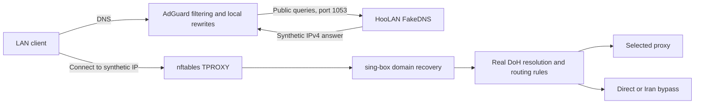

# FakeDNS

[Home](../README.md) · [Routing](routing.md) · [Troubleshooting](troubleshooting.md) · [فارسی](fakedns-fa.md)

FakeDNS is opt-in under **Settings → Routing & DNS**. It uses sing-box 1.14's
FakeIP DNS server: non-bypass client A queries receive addresses from `198.18.0.0/15`.
When a client connects, sing-box recovers the domain from its mapping store,
resolves it through encrypted DNS and evaluates the usual routing rules.
Bypassed domains retain real answers from Direct DNS. Configure both resolvers
using the [split-DNS guide](split-dns.md).



## Docker AdGuard and OpenWrt SmartDNS

1. Install the updated HooLAN binary **and** `scripts/tproxy/apply.sh`,
   `tproxy.nft.template` and `diagnose.sh`. Keep your existing `tproxy.conf`.
2. In Settings, enable FakeDNS and enter a **specific private IPv4 address
   assigned to the Debian host** that the AdGuard container can reach. This can
   be the host's LAN address or its Docker bridge address. `127.0.0.1` is the
   safe default and is appropriate only when the DNS caller shares the host
   network namespace; inside a normal Docker container it points to the container.
   Wildcard/public binds and IPv6 binds are rejected.
3. Save settings and ensure the proxy engine is ON. Both TCP and UDP must bind
   successfully before HooLAN installs interception. Permit AdGuard to reach
   that host address on TCP/UDP 1053 in your existing firewall. Do not publish
   this listener on the internet. HooLAN does not change Docker networks or
   take over AdGuard's port 53.
4. Replace AdGuard's **public-domain upstream** with `HOST_IP:1053`, substituting
   the actual address from step 2. Leave clients using AdGuard as their DNS.
   Keep local rewrites, local-domain conditional forwarding and private reverse
   DNS on AdGuard/SmartDNS. Do not send these back to HooLAN in a resolver loop.
5. **Keep the Debian host and Docker workloads on real DNS.** Use AdGuard
   per-client upstream overrides to retain SmartDNS for these callers, or give
   them a separate real resolver. Only clients whose IPv4 connections traverse
   HooLAN's LAN TPROXY interface may receive synthetic answers. Host output and
   Docker ingress deliberately bypass TPROXY; fake addresses cannot work there.
6. Remove parallel/fallback public SmartDNS upstreams for the protected LAN
   clients. Otherwise AdGuard can return real answers outside FakeDNS. Clear
   AdGuard's cache and reconnect/flush DNS on the test client.

Use a DHCP reservation for the gateway and client devices. If AdGuard has a
custom rule that rejects the benchmark pool, allow these upstream responses.
Apps that require DNSSEC-authenticated A records cannot validate synthesized
answers. Keep those clients on a separate real encrypted resolver.

## Verify

On a machine that can reach the selected listener (replace `HOST_IP`):

```bash
dig @HOST_IP -p 1053 example.com A +short
dig @HOST_IP -p 1053 example.com A +tcp +short
dig @HOST_IP -p 1053 example.com AAAA
```

Both A queries should return the same address in `198.18.0.0/15`. AAAA receives
an empty successful answer. Repeat the A query through AdGuard on port 53,
then open a website from an affected LAN client. An A answer alone proves the
DNS listener works, not that the client uses the gateway for its connection.

```bash
sudo ss -lntup '( sport = :1053 )'
sudo nft -a list table inet proxy_tproxy
sudo nft -a list table inet hoolan_fakedns
sudo bash /opt/hoolan/scripts/tproxy/diagnose.sh 192.168.3.141
```

Increasing guard drops indicate synthetic destinations reached ordinary
forwarding/output instead of successful engine delivery. Check gateway routes,
TPROXY socket ownership, source/interface exemptions and accidental FakeDNS use
by the host or Docker workloads. Do not solve this by NATing synthetic IPs.

## DNS and routing behavior

- Only DNS from the dedicated listener and TPROXY listeners is eligible for fake
  A answers. Engine endpoint/bootstrap queries always use a real resolver.
- Public TCP/UDP port 53 intercepted from LAN clients uses `hijack-dns` before
  sniffing or routing. DNS to local/private services still bypasses nftables;
  AdGuard must explicitly use the FakeDNS upstream.
- Known direct domains use the configured Direct DNS server. Non-bypass answers
  and real lookups for synthetic destinations use Tunneled DoH through the global
  selected proxy. Device assignments do not change that DNS transport.
- Proxy endpoint and rule-set bootstrap use Direct DNS to avoid recursive proxy
  dependencies. Use IP-based proxy endpoints with correct TLS SNI when bootstrap
  DNS is untrusted. Tunneled DoH never falls back to direct transport.
- Both resolver fields remain active in FakeDNS mode. GeoIP/address criteria
  evaluate an encrypted real answer before selecting Direct DNS. See
  [matching and bootstrap](split-dns.md#matching-and-bootstrap).
- IPv4 only: AAAA and HTTPS/SVCB queries receive empty successful answers to
  avoid IPv6/address-hint escapes. This can disable some client optimizations.
  It does not disable IPv6 on the LAN or intercept application DoH/DoT. Configure
  those separately; FakeDNS is not a guarantee that all traffic avoids censorship.

## Per-device QoS

sing-box 1.14 reports recovered-domain connections without a destination IP in
Clash metadata. HooLAN retains original fake-address tuples in a bounded nftables
set for limited devices (8192 entries, five-second expiry). The sampler combines
these with the reported direct/proxy class; it does not guess an IP from SNI or
repeat a DNS lookup. Ambiguous/reused tuples, missing observations and sampler
errors retain the existing stricter unknown-traffic cap. Usage byte attribution
still uses the original client IP. This remains sampled classification, not
perfect accounting of short flows.

## Cache, shutdown and recovery

Mappings are stored with `store_fakeip` in sing-box's configured cache file,
normally `/var/lib/hoolan/cache.db`. Keep this file across ordinary restarts.
Fake A answers have a 60-second TTL, although client applications may cache longer.
The cache is not part of the backup ZIP; clear downstream caches after restoring
to another host, deleting the cache or recovering from mapping loss.

**Before turning the proxy engine OFF**, return AdGuard's protected
clients to their normal real upstream, clear its DNS cache, then flush client
DNS/reconnect applications. The DNS listener stops with the engine. HooLAN
cannot remotely clear AdGuard or client caches, and cached fake addresses cannot
be forwarded as ordinary internet addresses.

The independent `inet hoolan_fakedns` table drops synthetic destinations at
FORWARD and OUTPUT. It is installed atomically with interception and remains
through OFF, disabling FakeDNS and standalone script application to protect
stale caches. Successful TPROXY connections go to INPUT and are unaffected.
It reserves `198.18.0.0/15` on this gateway. Once all fake caches have been cleared,
an administrator who needs that range for another purpose can remove only this
owned guard with `sudo nft delete table inet hoolan_fakedns` while FakeDNS is OFF.

## References

The generated configuration follows sing-box's [FakeIP server](https://sing-box.sagernet.org/configuration/dns/server/fakeip/),
[DNS rule actions](https://sing-box.sagernet.org/configuration/dns/rule_action/),
[HTTPS DNS](https://sing-box.sagernet.org/configuration/dns/server/https/) and
[persistent cache](https://sing-box.sagernet.org/configuration/experimental/cache-file/) documentation.

Disabling only FakeDNS keeps split DNS on port 1053 running; clear cached
synthetic answers. Stopping the engine always stops this listener.
