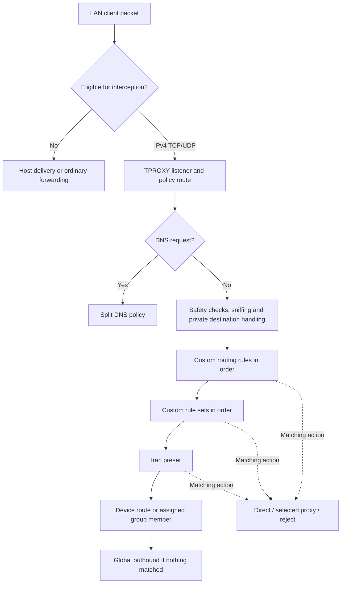
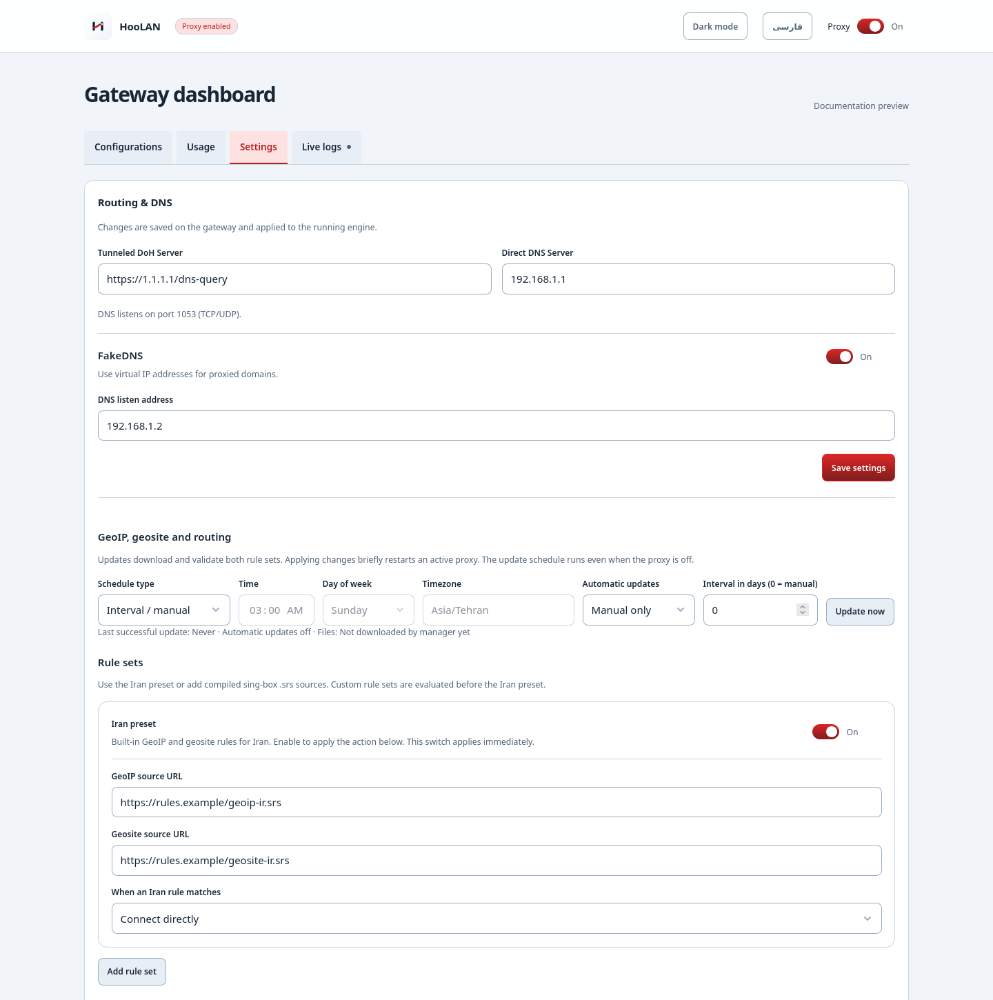
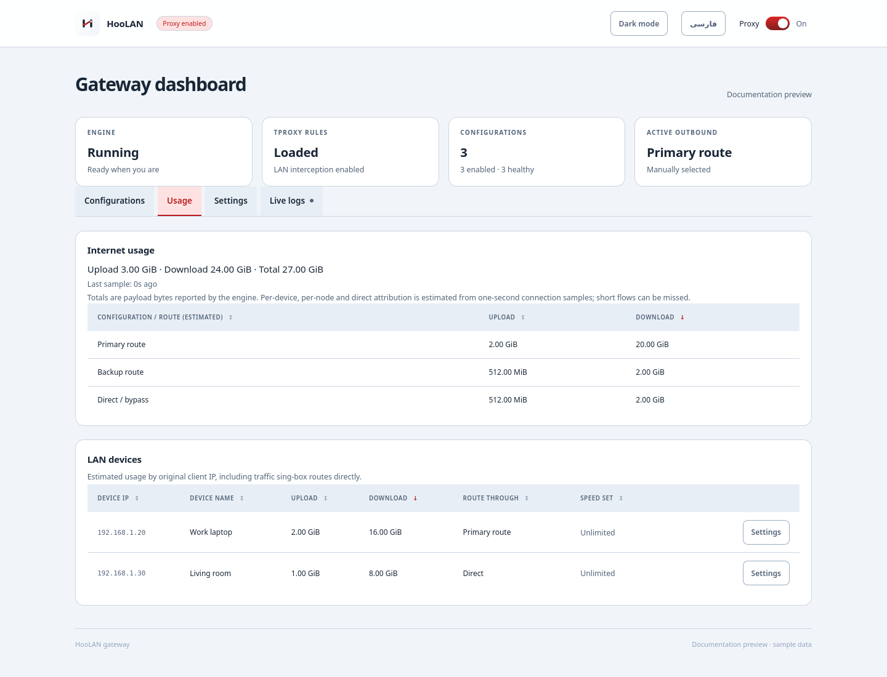

# Routing guide

[Home](../README.md) · [Documentation](../README.md#documentation) · [DNS & FakeDNS](dns.md) · [Devices](devices.md)

HooLAN decides which connections use a proxy, connect directly or are rejected.
Configure the policy in **Settings → Routing & DNS**. Choose the global outbound
in **Configurations**, and assign individual devices in **Usage → Settings**.

## How routing works

There are two decisions: the host first decides whether to intercept a packet,
then sing-box decides where an intercepted connection should go.



The rule sequence stops at the first matching terminal action. Sniffing gathers
information and continues evaluation; it is not itself an outbound choice.

## 1. Host interception

The `inet proxy_tproxy` table handles prerouting at priority `mangle` (`-150`).
This runs before destination NAT, so host services are recognized by their
original address. Only eligible IPv4 TCP/UDP arriving on `LAN_IF` is intercepted.

The following traffic stays outside the proxy:

- Loopback and Docker bridge/veth ingress, and traffic arriving on another interface.
- Addresses belonging to the host, broadcast and multicast destinations.
- Destinations in the LAN interface's subnets, private ranges, link-local,
  loopback, CGNAT and other reserved ranges listed in the template.
- Source networks configured in `SELF_ORIGIN_NETS` and invalid/loopback sources.
- Protocols other than TCP and UDP, and IPv6 traffic.

A bypass means ordinary host delivery or forwarding, not guaranteed internet
access: the host firewall and routing still apply. Traffic between devices on
the same subnet may never pass through HooLAN at all. A dashboard rule cannot
force traffic excluded at this stage into sing-box.

For intercepted traffic, nftables assigns a transparent socket and then sets
the reserved packet mark (default `0x1`). Policy routing sends that mark to a
local route through `lo` in table `100`. TPROXY preserves the client's source IP
and the original destination; it does not rewrite the destination to the proxy
server. Established packets are intercepted too.

The mark is applied after successful socket assignment. If assignment fails,
the rules record the failure and allow ordinary forwarding, subject to the
host's forwarding/NAT configuration. This is not a guaranteed fail-closed proxy
policy. FakeDNS destinations have a separate guard because virtual addresses
cannot be forwarded normally.

## 2. Engine routing order

For normal client connections, the generated policy has this precedence:

| Priority | Decision | Result |
| --- | --- | --- |
| DNS handling | Dedicated DNS inbound, intercepted port 53 or detected DNS | Use the DNS policy instead of an ordinary device route |
| Safety and discovery | Reject private-address connections to transparent listener ports; sniff HTTP, TLS, QUIC and DNS | Prevent listener loops and recover available domain information |
| Private destinations | Private IP destinations reaching the engine | Connect directly |
| Custom routing rules | Enabled domain, domain suffix and IP CIDR rules, in displayed order | Apply the first matching action |
| Custom rule sets | Enabled compiled sources, in displayed order | Apply the first matching action |
| Iran preset | Enabled GeoIP/geosite matches | Apply the preset's saved action |
| Device/group routing | Assigned device outbound or distribution listener member | Use the assigned route |
| Global default | No earlier match | Use the selected global outbound |

Dedicated DNS and intercepted port-53 handling are placed ahead of ordinary
connection rules; detected DNS is handled after sniffing. With FakeDNS, the
engine recovers the domain and performs real-address resolution as needed before
address-dependent decisions. If optional engine-level ad blocking is configured,
its rejection rules also precede the editable custom policy.

Domain rules need a known domain, obtained from sniffing or DNS/FakeIP mapping.
An application using only an IP address, or hiding its hostname, may not match a
domain rule. An IP CIDR rule can still match the destination address. Sniffing
does not decrypt application traffic.

### What the actions mean

| Action | Behavior |
| --- | --- |
| `direct` | sing-box opens an ordinary outbound connection from the Debian host |
| `proxy` | Use the global selected proxy, chain or group |
| `reject` | Refuse the matching connection |

`proxy` in a custom rule is not a reference to the device's assigned node. Since
custom rules precede device assignments, a matching `proxy` rule uses the global
selection even for a device assigned to another node.

## 3. Create custom routing rules

Under **Custom routing rules**, select **Add rule**, give it a descriptive name,
enable it, choose a match type and enter one value per line. Choose an action,
use **Move up / Move down** to set precedence, then **Save routing rules**.

| Match type | Example | Matches |
| --- | --- | --- |
| `domain` | `portal.example.com` | That exact hostname |
| `domain_suffix` | `example.com` | That domain and its subdomains |
| `ip_cidr` | `203.0.113.0/24` | Addresses inside the destination network |
| `ip_cidr` | `203.0.113.10/32` | One destination IPv4 address |

Values within one rule are alternatives. Use hostnames without `https://`,
paths, ports, wildcards or trailing dots. Internationalized names must be
ASCII/punycode. IP entries require CIDR notation. The editor supports up to
100 rules and 100 values per rule; names are required and limited to 100 characters.

For example, to proxy `portal.example.com` while connecting directly to the
rest of `example.com`, place an exact-domain **proxy** rule above the suffix
**direct** rule. Reversing them makes the broader direct rule win.

Disabling a rule keeps its configuration but removes it from evaluation.
Reordering custom rules only changes their order within that section; it does
not move them below the Iran preset or above the host's private-network bypass.

## 4. Rule sets and the Iran preset

Rule sets are compiled sing-box `.srs` files containing reusable matching data.
They are not subscription links, plain domain lists or arbitrary JSON configs.

To add a source:

1. Select **Add rule set** under **Rule sets**.
2. Enter a unique tag beginning with `custom-`, such as `custom-work`.
3. Enter the HTTPS URL of a compiled `.srs` file.
4. Enable the source and choose `direct`, `proxy` or `reject`.
5. Set its position and select **Save routing rules**.

Tags allow lowercase letters, digits and hyphens, up to 80 characters. Up to
20 custom sources are supported. Source URLs cannot contain credentials or
fragments. Enabled custom sources run after custom routing rules and before
the Iran preset. Multiple matching sources therefore use the first one's action.

The **Iran preset** combines GeoIP address ranges and geosite domains. Its
switch applies immediately; source URL and action edits require **Save routing
rules**. The default action is direct, but proxy and reject are also supported.
Turning the preset off removes its matches without deleting the saved sources.
Country classification depends on the supplied lists; it is not a live location
lookup or a guarantee about every domain's hosting location.

## 5. Device routes, chains and load balancing

In **Usage**, open a device's **Settings** and choose its outbound:

- **Global Default:** follow the global selection after earlier policy rules.
- **Direct:** connect directly after earlier policy rules.
- **Specific configuration or chain:** use that saved outbound for remaining traffic.
- **Load-balanced group:** use the group's saved strategy for remaining traffic.

Assignments are stored by client IP. Reserve addresses in DHCP so an assignment
continues to identify the same device. Missing or disabled node assignments fall
back to the global default. A device-specific route does not override a reject
rule, a direct custom rule or the Iran preset.

Chains use their saved sequence of hops. Hash-distribution groups use nftables
to choose a separate transparent listener per member and keep a flow on that
member; earlier engine bypass rules can still route it directly. Best-latency
groups use sing-box URLTest to select a measured path. Neither strategy combines
one transfer across several proxies or measures remote server CPU load.
See [chains](configurations.md) and [load balancing](load-balancing.md).

## 6. DNS and FakeDNS

DNS listens on **TCP/UDP port 1053** while HooLAN runs, including engine OFF. Direct/local matches
use **Direct DNS Server**; remaining real queries use **Tunneled DoH Server**
through the global active proxy. If proxy DNS is unavailable while proxy mode
is enabled, the listener returns a DNS error without retrying Direct DNS.
Reloads and crashes retain this protection; explicitly switching OFF uses Direct DNS. DNS decisions follow
the applicable ordered domain/rule-set policy, not a device-specific DNS proxy.

IP/GeoIP rules need an answer before they can be evaluated. The engine obtains
an encrypted answer first; a direct match then uses Direct DNS. Bootstrap names
for proxy endpoints and rule downloads use Direct DNS to avoid dependency loops.
FakeDNS optionally supplies virtual IPv4 addresses for proxied domains and
retains the domain mapping for subsequent connections.

The DNS policy and connection policy are related but distinct: resolving a name
successfully does not prove that a later connection used a particular outbound.
See [DNS & FakeDNS](dns.md) for matching details, tests and cache handling.

## 7. Rule-set updates and storage

Choose a manual update policy, an interval of 1–365 days, daily at a selected
time, or weekly on a selected day/time. Calendar schedules use the saved IANA
timezone, for example `Asia/Tehran`. Every 30 days is an elapsed interval, not a
calendar-month schedule. Interval `0` disables automatic updates.

Select **Save routing rules** before **Update now**, which starts a background
job using the saved policy. The Go scheduler runs while the HooLAN service is
running, including when its proxy engine is OFF. It cannot run while the service
itself is stopped. Disabled sources are downloaded too so they are ready to enable.

Downloads are staged and validated with sing-box's rule-set decompiler before a
new generation is published. Invalid downloads do not overwrite live files.
Each file is limited to 16 MiB. Settings reports the last successful update,
next due time, file paths and most recent error.

With the default installation, generated rule-set directories are under
`/etc/hoolan/singbox/rule-sets/`. Use the paths reported by Settings or
`GET /api/rules` if the installation uses a different configuration path.
Policies and schedules persist in `/var/lib/hoolan/state.json`. Backups include
those settings but not the downloaded `.srs` payloads. Do not edit generated
`config.json` or generation files to make persistent policy changes.

Saving policy can briefly restart a running engine. Save DNS fields with
**Save settings** and rule sources/matches/schedules with **Save routing rules**;
these are separate forms. The Iran preset switch is the immediate-action exception.

## 8. Direct traffic, speed limits and engine OFF

Direct traffic has two paths: nftables-bypassed packets use normal host
forwarding, while engine-routed direct connections use sing-box's local sockets.
The latter appear in engine usage estimates; raw forwarded traffic does not.
Forwarded clients need host forwarding and a return route or scoped NAT. Locally
created sing-box sockets do not need a LAN-client MASQUERADE rule.

The TPROXY mark means intercepted, not necessarily proxied. Four-way device
limits use additional connection observations to distinguish proxy and direct
traffic. Limits are packet-drop policing, with stricter handling for unclassified
traffic; see [device limits](devices.md).

Turning the engine OFF removes interception while leaving separately configured
forwarding/NAT and device limits in place. Port 1053 remains available through
HooLAN and uses Direct DNS while the engine is off. Clear virtual-address caches
if FakeDNS was enabled. Stopping HooLAN itself still stops DNS. The FakeDNS guard remains to prevent stale virtual destinations
from being forwarded as real internet traffic.

## Verify a routing change

1. Save the relevant form and check for a reported error.
2. Start a new connection from an actual LAN client; an already open connection
   or cached DNS answer may not demonstrate the new policy.
3. Test a custom-rule domain, an Iran match and an unmatched destination separately.
4. Check **Live logs** for the destination and chosen outbound where reported.
   Usage attribution is sampled and may miss short tests.
5. If traffic never reaches the engine, inspect interception before changing rules:

```bash
sudo bash /opt/hoolan/scripts/tproxy/diagnose.sh CLIENT_IP
sudo nft list table inet proxy_tproxy
ip -4 rule show
ip -4 route show table 100
sudo journalctl -u hoolan -n 80 --no-pager
```

Replace `CLIENT_IP` and table `100` if your configuration differs. The
`tproxy_attempt_*`, `tproxy_assigned_*`, `tproxy_failed_*` and `marked_input`
counters help distinguish socket assignment from local delivery. Other firewall
chains can still reject a packet after it reaches an observation counter.
See [troubleshooting](troubleshooting.md) for listener and forwarding checks.

## Screenshots

The following captures use the current dashboard with illustrative sample data.
Source URLs shown in the preview are examples, not downloadable rule lists.

### Routing & DNS settings

<picture>
  <source media="(prefers-color-scheme: dark)" srcset="images/routing-dns-dark.png" />
  <source media="(prefers-color-scheme: light)" srcset="images/routing-dns-light.png" />
  
</picture>

### Device routing and usage

<picture>
  <source media="(prefers-color-scheme: dark)" srcset="images/usage-dark.png" />
  <source media="(prefers-color-scheme: light)" srcset="images/usage-light.png" />
  
</picture>
