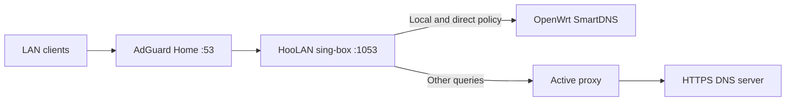

# Split DNS with AdGuard Home

[Home](../README.md) · [Routing](routing.md) · [FakeDNS](fakedns.md) · [فارسی](split-dns-fa.md)

HooLAN provides a TCP/UDP DNS listener on port **1053** while sing-box is running.
AdGuard keeps port **53**, filtering and local rewrites. Requests forwarded to
HooLAN follow the routing policy: known local/bypassed domains use Direct DNS,
and other requests use encrypted DoH through the global active proxy.



## Setup

1. In **Settings → Routing & DNS**, set **Tunneled DoH Server**, for example
   `https://1.1.1.1/dns-query`, and **Direct DNS Server**, for example
   `192.168.3.1` (your OpenWrt router). Direct DNS accepts an IP with an optional
   port. These defaults are examples, not automatic router discovery.
2. Set **DNS listen address**. AdGuard sharing the Debian host's network can
   use the default `127.0.0.1`. For a normal Docker container, use a specific
   private address assigned to the Debian host that the container can reach,
   such as its Docker bridge or LAN address. A container's loopback is not the
   host's loopback. This setting applies with FakeDNS both on and off.
3. Save settings and leave the engine **ON**. Allow TCP and UDP port 1053 from
   AdGuard through your existing host firewall; do not expose this listener
   publicly. HooLAN checks ownership of both DNS sockets before interception.
4. In AdGuard, set the upstream to `HOST_IP:1053`, using the address from step 2.
   Keep AdGuard filtering, rewrites and local conditional forwarding. Keep LAN
   DHCP advertising AdGuard on port 53. No change to the Docker port-53 mapping
   or nftables local-service bypass is required.
5. SmartDNS must use its own upstreams. **Do not point Direct DNS at AdGuard or
   back at HooLAN**, or forward SmartDNS back to either: that creates a loop.
   Remove parallel/fallback unencrypted upstreams in AdGuard for protected
   clients if you require all non-bypass queries to use tunneled DoH.
6. Clear AdGuard and client DNS caches so old answers do not hide the change.

## Matching and bootstrap

- Local suffixes `lan`, `local`, `home.arpa` and reverse zones `in-addr.arpa` /
  `ip6.arpa` use Direct DNS. AdGuard can answer its local rewrites first.
- Enabled custom domain rules, custom rule sets and the Iran preset follow
  their routing order. Direct rules select Direct DNS, proxy exceptions select
  tunneled DoH, and reject rules refuse the query. Disabling the Iran preset
  removes its DNS matches too. A proxy/reject Iran action is also respected.
- GeoIP/IP-CIDR matching needs an answer. At the first address-dependent rule,
  HooLAN evaluates the answer **through tunneled DoH**, then matches private
  addresses, custom address criteria and Iran GeoIP. A direct match performs
  a fresh Direct DNS lookup; otherwise the encrypted answer is reused.
  Custom `.srs` files may contain addresses, so they also require evaluation.
  Known domain rules before that point can reach SmartDNS without querying DoH.
  Unknown domains cannot be classified by GeoIP while the proxy is unavailable.
- Proxy endpoint names, rule-set download hosts and hostname-based DoH bootstrap
  use Direct DNS to avoid a proxy/DNS dependency cycle. Those bootstrap lookups
  are a deliberate exception to tunneled client DNS. An IP-based DoH URL avoids
  bootstrap for the DoH endpoint itself; proxy nodes with IP servers and correct
  TLS SNI avoid endpoint DNS poisoning. HTTPS certificate verification stays on.
- DoH uses the global selector, including its selected chain/group. It never
  falls back to direct transport. A failed global proxy causes non-bypass real DNS resolution
  to fail. FakeDNS may still allocate a synthetic answer; the later connection
  cannot resolve its real destination until the proxy recovers. AdGuard forwarding hides original client identities, so per-device
  outbound assignments do not select different DNS proxies. Connection-hash
  groups use their selector for this locally generated connection.
- Split DNS does not intercept application DoH/DoT or IPv6 traffic. Configure
  those separately if clients must use AdGuard exclusively.

## FakeDNS and engine shutdown

Leave FakeDNS **OFF** for ordinary real DNS answers. Enable it only for LAN
clients whose connections traverse HooLAN's TPROXY gateway: non-bypass A queries
then receive synthetic addresses, while known bypass domains retain real answers.
The existing IPv4-only FakeDNS behavior suppresses AAAA and HTTPS/SVCB answers.
See [FakeDNS](fakedns.md) for host/Docker exclusions and cache requirements.

**Stopping the engine stops port 1053 even when FakeDNS is off.** Before stopping,
return AdGuard to its normal upstream. HooLAN does not edit AdGuard configuration
or keep a separate DNS process running while OFF. If FakeDNS was enabled, also
clear AdGuard/client caches before raw forwarding resumes. Merely disabling
FakeDNS leaves split DNS running; clear cached synthetic answers after that change.

## Check

```bash
# Replace HOST_IP with the configured listener address.
dig @HOST_IP -p 1053 example.com A
dig @HOST_IP -p 1053 example.com A +tcp
dig @HOST_IP -p 1053 router.lan A
sudo ss -lntup '( sport = :1053 )'
```

Test a domain covered by your Iran/custom direct rule as well. Compare logs in
HooLAN and SmartDNS to verify the chosen DNS path; an answer alone does not prove
proxy transport. If port 1053 fails, check engine status, address ownership,
Docker reachability and firewall access. If only public names fail, check the
active proxy and DoH URL. Do not disable certificate verification to hide errors.

## API and sing-box format

```json
{
  "tunneled_doh": "https://1.1.1.1/dns-query",
  "direct_dns": "192.168.3.1",
  "fake_dns": {"enabled": false, "listen": "127.0.0.1"}
}
```

Send this to `PUT /api/settings`. Omitted fields retain their settings. Both
resolver fields are persisted in `state.json` and included in backups. Older
`dns_server` values are inherited as Direct DNS; the legacy API field remains
an input alias for older clients. New clients should use `direct_dns`.

The generated configuration targets **sing-box 1.14+**: a `direct` inbound tagged
`dns-in`, the `hijack-dns` route action, typed `https` / `udp` DNS servers tagged
`dns-remote` / `dns-direct`, and `evaluate` / `match_response` for address rules.
DoH has a detour through the active selector. Typed UDP uses its own direct dialer;
it does not require a detour to an empty `direct` outbound. The removed legacy
`dns` outbound, DNS `address`, `geosite` and `geoip` fields are not generated.
See the official [DNS actions](https://sing-box.sagernet.org/configuration/dns/rule_action/)
and [migration guide](https://sing-box.sagernet.org/migration/).
